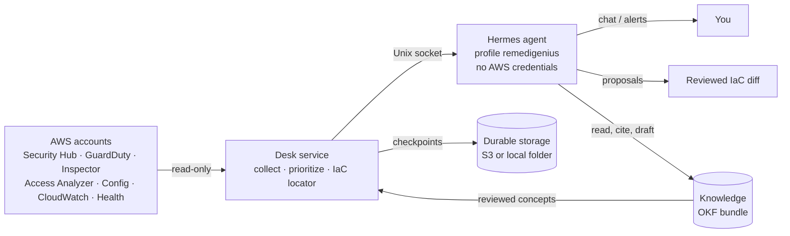

# RemediGenius Community Edition (RemediGenius-CE)

**Your AWS security services already found the problems. RemediGenius-CE makes sure you see the
right ones first, understand them, and get the code change that fixes them.**

RemediGenius-CE is a security desk that runs on the open-source [Hermes agent](https://github.com/NousResearch/hermes-agent).
Once an AWS account is connected, it:

1. **Collects** findings, alerts and events from Security Hub (including its exposure findings and attack paths),
   GuardDuty, Inspector, IAM Access Analyzer, AWS Config, CloudWatch alarms and AWS Health. Collection is read-only and
   deterministic, and every board says what was inspected and what was not.
2. **Prioritizes** them P1–P4 with a written reason for every point of the score, using severity, exploitability,
   exposure, active threats, "toxic combinations" on one resource, and your business context.
3. **Brings them to you.** Every chat opens with the attention board, and an optional schedule alerts you to new P1/P2 items.
   In an AWS Organization it finds the other accounts by itself and says which ones it cannot read yet, and why.
4. **Answers from live evidence.** A finding is a lead, not proof: the agent checks it with read-only calls, cites
   the evidence for every observed fact, keeps what configuration *could* allow apart from what logs show *did*
   happen, and says "not confirmed" or asks you rather than guess.
5. **Proposes the fix in your IaC.** It finds the Terraform, CloudFormation or CDK that deployed the resource,
   writes a minimal diff in your repository's style and runs `terraform validate` on a scratch copy. You apply it
   through your own PR and CI/CD; the desk tracks the fix until a proof-of-done read passes and the AWS finding is gone.
6. **Knows your organization.** One [Open Knowledge Format](https://github.com/GoogleCloudPlatform/open-knowledge-format)
   bundle holds who owns what, how critical it is, accepted risks, policies and runbooks, next to shipped guides on
   where to find evidence. Reviewed concepts change priorities, with a citation in every finding. The dashboard
   **Knowledge** tab is where people add, import (PDF, Word, PowerPoint, Excel), review and explore it as a graph; the
   agent drafts what it learns for a person to approve.
7. **Gets better from use, under your control.** Answers are traced (redacted) and can be rated or corrected. Offline,
   the desk replays a fixed evaluation organization, proposes skill improvements (SkillOpt-style bounded edits,
   Harness²-style Propose–Probe–Compose), and a security gate plus your approval decide what the agent uses. See
   [docs/IMPROVEMENT.md](docs/IMPROVEMENT.md).

**What it is not.** It has no detectors of its own: a quiet board means your AWS services reported nothing where the
desk looked. It uses the model provider you configure, and findings, identifiers, IaC excerpts, knowledge and chat go
to that provider ([what leaves your environment](docs/DATA-FLOW.md)). One operator, one organization per installation.

At scale it shows fixes rather than findings. 40,000 Inspector findings become "rebuild this AMI" and
"upgrade this package (37 with public exploits)", and a CVE's severity alone never makes it P1.

## Start

| Path | For | Guide |
| --- | --- | --- |
| **Docker workstation** | Trying it on your own machine | [docs/WORKSTATION.md](docs/WORKSTATION.md) |
| **AWS Spot instance** | A persistent deployment in your account | [deploy/aws-single/README.md](deploy/aws-single/README.md) |
| **Existing Hermes** | You already run Hermes locally | [docs/LOCAL-HERMES.md](docs/LOCAL-HERMES.md) |
| **Offline demo** | See the pipeline with synthetic data, no AWS or model | `python tools/demo.py` |

All paths use the same Hermes profile, `remedigenius`, and the same desk service. See [START-HERE.md](START-HERE.md)
for the five-minute orientation.

## Safety model

- **Read-only by construction.** Every AWS call passes a botocore hook that refuses anything but
  describe/get/list/lookup/search, plus reads that would return secrets or data. This holds even with admin keys.
  Deployments also use a read-only role (SecurityAudit + ViewOnlyAccess with explicit denies).
- **The agent never holds AWS credentials.** Only the desk service does; Hermes talks to it over a Unix socket.
- **No silent changes.** The agent cannot edit your repositories (only a proposals folder), cannot read credential
  files, and every triage decision goes through Hermes's approval prompt. Knowledge it learns stays a draft until a
  person approves it in the Knowledge tab.
- **Durable state.** Conversations, decisions and scan history are checkpointed to S3 (Spot) or a folder on your
  machine (workstation). A replaced Spot instance or a wiped Docker volume restores itself.

Details: [docs/ARCHITECTURE.md](docs/ARCHITECTURE.md) · [docs/KNOWLEDGE.md](docs/KNOWLEDGE.md) · [docs/IMPROVEMENT.md](docs/IMPROVEMENT.md) · [docs/MULTI-ACCOUNT.md](docs/MULTI-ACCOUNT.md) · [docs/IAM.md](docs/IAM.md) · [docs/LIMITS.md](docs/LIMITS.md)

## Validated configuration

AWS us-east-1 · Hermes `nousresearch/hermes-agent:stable@sha256:444b4259…` (0.21.7) · model `deepseek-v4.1-flash`
(OpenAI-compatible endpoint). Other Hermes-supported models work but are your choice. Evidence and exact scope:
[docs/RELEASE-VALIDATION.md](docs/RELEASE-VALIDATION.md).

Provided as-is under Apache-2.0. You choose your model provider and AWS account and are responsible for their
configuration, data handling and charges; selected findings and context are sent to your model provider.

[Changelog](CHANGELOG.md) · [Upgrading](docs/UPGRADING.md) · [Troubleshooting](docs/TROUBLESHOOTING.md) ·
[Contributing](CONTRIBUTING.md) · [Security](SECURITY.md)
