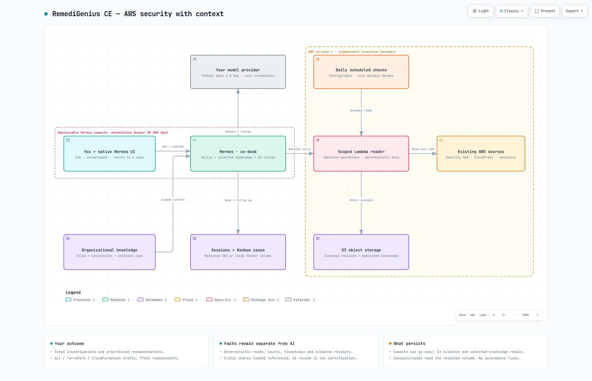

# RemediGenius Community Edition

**Turn your existing AWS security data into an investigation, a practical fix proposal, and a follow-up you can return to.**

Self-hosted · one native Hermes `ce-desk` profile · Apache-2.0 · **v0.1 preview**

**Preview baseline: AWS `us-east-1` and Qwen 3.8 Max.** Bring your own AWS account and model access. Other regions and providers are configurable, but are outside this release's validated baseline.

[Explore the architecture](docs/diagrams/ce-mvp-architecture.html) · [Architecture and capability detail](docs/CURRENT-CE-OFFERING.md)

## Start with a useful question

- **Security posture:** “Read current Security Hub findings. What needs attention first, and what coverage is missing?”
- **Investigation:** “Show EC2 CloudTrail management events for the last five days. State actual time coverage and collection limits.”
- **Remediation:** “Explain this finding using our policy. Prepare a CLI fix, save a case, and help me reassess after our change window.”

CE reuses Hermes's conversation, skills, model routing and manual Kanban. A small native runtime plugin admits bounded operations and shares retrieved context with a critic. Separate deterministic Lambda collectors retrieve AWS records and write receipts to S3. The model interprets evidence; it does not rewrite source observations or apply customer-cloud fixes.

## Choose your setup

| | Workstation | Your AWS account |
|---|---|---|
| Hermes compute | Official pinned Docker container | Same container on Spot EC2 |
| Collection and evidence | AWS Lambda and private S3 | AWS Lambda and private S3 |
| Conversations and cases | Named Docker volume | Retained encrypted EBS |
| Login | Local dashboard, generated credentials | Private SSM tunnel, generated credentials |
| Walkthrough | [Start on your workstation](docs/WORKSTATION-HERMES.md) | [Deploy in AWS](docs/NATIVE-CE-QUICKSTART.md) |

Both paths use your AWS and model accounts and incur their charges. Local means local agent compute, not offline. Start with [Start Here](START-HERE.md) and [required inputs and credentials](docs/PREVIEW-ONBOARDING.md). The cloud path requires an existing subnet and private bucket; the workstation Terraform creates its own evidence bucket. Source and Terraform remain inspectable and customizable.

## What you get

| Included in the preview | Boundary |
|---|---|
| Scoped AWS reads, records, counts and receipts | Bounded queries; unavailable services are not healthy services |
| Selected organizational knowledge | Import files, publish/mount a view, show sources and their effect on advice |
| Layered prioritization | Coverage, exposure, business context and existing control metadata; no compliance certification |
| CLI-first remediation proposals | Ask for Terraform/CloudFormation alternatives or source-specific edits; drafts need operator review |
| Saved findings and reassessment | Native manual Kanban and fresh evidence; no automatic closure |
| Configurable daily collection | Deterministic AWS checks, independent of agent compute; no unattended model investigation |
| Bounded AI critique | Same loaded references and bounded evidence; not a guarantee of correctness |

Not included: autonomous remediation, automatic organization enrollment, universal repository OAuth, live Confluence sync, Security Lake record analytics, Azure/GCP collectors, hosted multi-tenancy, or a public production MCP/API/A2A service. The older custom console is preserved in source; root Compose does **not** start native CE.

[Illustrated first-use walkthrough](docs/MVP-WALKTHROUGH.md) · [Login and profile screenshots](docs/NATIVE-CE-QUICKSTART.md#3-retrieve-your-login-open-the-tunnel-and-select-ce-desk)

## Bring context, see it used, return later

1. Ask Hermes what sources and scope it can actually read, then collect one bounded result.
2. Follow [the knowledge walkthrough](docs/NATIVE-KNOWLEDGE-QUICKSTART.md) to import one real policy or ownership note. Generated views are readable; edit originals and re-import rather than editing view hashes.
3. Ask: “Which knowledge did you use, why does it apply, and what changed in your recommendation?” Conflicts and unknown applicability stay explicit.
4. Prepare a proposal and save it on [native Kanban](docs/OPERATING-LOOP.md). After your change process, return to the case and collect fresh evidence.

## Evidence, limits and project source

- [Release checklist and known limits](docs/V0.1-RELEASE-PLAN.md)
- [MVP acceptance: Windows workstation, Windows/Linux source tests and live Qwen](docs/MVP-ACCEPTANCE.md)
- [Skill improvements: broader Pi evaluation and native Qwen retests](docs/SKILL-EVALUATION-2026-10-15.md)
- [AWS capabilities and scope](docs/AWS-READ-EXECUTION.md)
- [Workstation acceptance](docs/WORKSTATION-ACCEPTANCE.md), [critic context acceptance](docs/CRITIC-CONTEXT-ACCEPTANCE.md), [remediation acceptance](docs/REMEDIATION-SKILL-ACCEPTANCE.md)
- [Runtime controls and extension boundaries](docs/CE-RUNTIME.md)
- [What CE adds to Hermes](docs/CE-PRODUCT-AND-INTEGRATION-CONTRACT.md)
- [Contributing and reporting issues](CONTRIBUTING.md)

| Source | Location |
|---|---|
| Native profile and readable skills | `profiles/native-sketch/desk` |
| Runtime gate and bounded critic | `profiles/native-sketch/desk/plugins/ce-runtime` |
| Deterministic collection | `modules/aws-read-executor` |
| Workstation / Spot Terraform | `deploy/aws-workstation` / `deploy/aws-native-sketch` |
| Launchers and verification | `tools` / `tests` |

Acceptance reports preserve partial and recovered results. CI execution status is distinct from local/live acceptance; see the release checklist. Never include credentials, Terraform state, private policies or unredacted transcripts in public issues.
