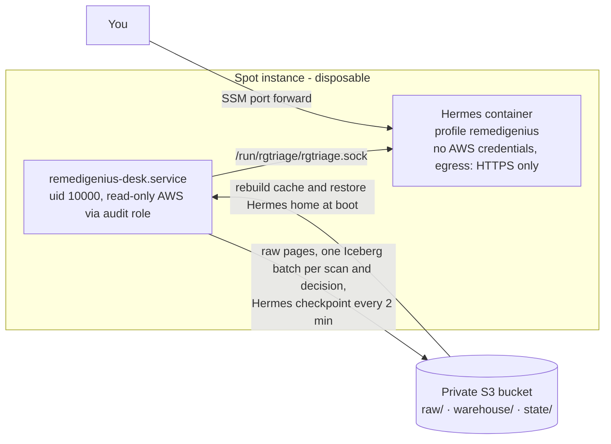

# RemediGenius Community Edition on one AWS Spot instance

A persistent RemediGenius-CE deployment in your account: one Spot instance in an Auto Scaling group and a private S3
bucket for raw evidence, Iceberg facts and checkpoints. The instance is disposable. If AWS reclaims it, the group
launches a new one and it rebuilds from S3.



## Before you begin

- Terraform ≥ 1.10, AWS CLI v2 with the Session Manager plugin, Python 3.11+
- A provisioning identity that can create IAM roles, an S3 bucket, a security group, a launch template and an
  Auto Scaling group. It is used only for `terraform apply`; it never reaches the instance.
- An existing subnet with outbound HTTPS (public with an internet gateway, or private with NAT). No inbound port is opened.
- Your model API key stored in Secrets Manager as a plain string. A customer-managed KMS key on the secret is detected
  and granted automatically.

## Deploy

```sh
git clone https://github.com/IaCGenius/RemediGenius.git && cd RemediGenius
python tools/package_release.py --spot dist/remedigenius-ce-spot.zip
cd deploy/aws-single
cp example.tfvars local.tfvars          # set account_id, subnet_id, source_zip, model_* (see below)
terraform init
terraform plan -var-file=local.tfvars
terraform apply -var-file=local.tfvars
```

| Variable | Default | Notes |
| --- | --- | --- |
| `account_id`, `subnet_id`, `source_zip` | required | `source_zip` = the archive built above |
| `name` | `remedigenius-ce` | stack, role and Auto Scaling group name |
| `model_secret_arn` | `""` | secret holding only the model key; without it, configure the model in the dashboard |
| `model_name` / `model_base_url` | `deepseek-v4.1-flash` / `""` | OpenAI-compatible endpoint; required with a secret |
| `regions` | `[]` (= `region`) | regions the desk reads |
| `scan_interval_hours` | `6` | background scans and new-P1/P2 alerts |
| `watch_deliver` | `local` | Hermes delivery target for alerts (`local`, or a messaging channel configured in Hermes); `""` = none |
| `running` | `true` | `false` scales to zero; state stays in S3 |
| `spot_instance_types` / `container_memory_mb` | `t3.large, t3a.large` / `6144` | |
| `public_ip` | `true` | `false` for a private subnet with NAT |
| `delete_data_on_destroy` | `false` | `true` lets `terraform destroy` delete the bucket, raw evidence and Iceberg facts |
| `raw_retention_days` | `90` | expire `raw/` response objects; `0` keeps them. Facts in Iceberg are not expired by this |

First boot takes about 5 minutes: packages, the pinned Hermes image, the desk runtime and a pinned, checksum-verified
Terraform binary for fix validation.

## Open the dashboard

```sh
bash tools/open-remedigenius.sh --with-login          # PowerShell: tools\open-remedigenius.ps1 -WithLogin
```

This prints the private login (from `/data/hermes/remedigenius-login.json`) and opens an SSM port-forward to
`http://127.0.0.1:9125/chat?profile=remedigenius`. Keep the window open; say "hi". The **Knowledge** tab holds what the
desk knows about your organization ([docs/KNOWLEDGE.md](../../docs/KNOWLEDGE.md)); its bundle is part of the desk state
in S3. Importing PDF or Office files installs markitdown into the Hermes home on first use (HTTPS egress, about 350 MB,
reinstalled after an instance replacement).

## What the stack creates

- **S3 bucket** (private, versioned, TLS-only, SSE-S3). `raw/` holds every collected response once, keyed by SHA-256;
  `warehouse/` holds the Iceberg tables; `state/` holds the Hermes home checkpoints (old versions expire after 30
  days); `source/` holds the archive the instance verifies by SHA-256 at boot.
- **Glue database** `<name>` for the Iceberg catalog. The instance role may use only that database and the `raw/` and
  `warehouse/` prefixes.
- **Instance role** with SSM core, its bucket, the model secret (+ KMS decrypt via Secrets Manager), and `sts:AssumeRole`
  on the audit role and any `member_role_arns`. It does **not** have AWS security read permissions itself.
- **Audit role** with `SecurityAudit` + `ViewOnlyAccess` and an explicit deny on credential and data reads (secrets,
  parameters, S3/DynamoDB object data, KMS decrypt). Every AWS read the desk makes uses this role.
- Security group with no inbound rules; IMDSv2 with hop limit 1, so containers cannot reach instance metadata.
- Launch template and Auto Scaling group (min 0, max 1, Spot only, price-capacity-optimized).

## On the instance

| Unit | Role |
| --- | --- |
| `remedigenius-desk.service` | `rgtriage serve` as uid 10000 with systemd sandboxing; Unix socket API; S3 checkpoints; Spot interruption watcher |
| `remedigenius-validate.service` | `rgtriage serve-validate` as its own user (uid 10002, no access to the GitHub key, blocked from instance metadata): runs Terraform, tflint and cfn-lint for `publish` and `validate` ([docs/GITHUB.md](../../docs/GITHUB.md)) |
| `remedigenius-scan.timer` | scheduled scan (3 minutes after boot, then every `scan_interval_hours`) |
| `remedigenius-hermes.service` | the pinned Hermes container: profile `remedigenius`, dashboard on `127.0.0.1:9120`, egress limited to HTTPS (no metadata, no private ranges) |

Desk state is in `/data/rgtriage`, the Hermes home in `/data/hermes`, and proposals the agent saves in `/opt/data/proposals`
(inside the Hermes home). IaC repositories go in `/data/iac` (clone them through an SSM session), mounted
read-only into the agent. Logs: `journalctl -u remedigenius-desk -u remedigenius-validate -u remedigenius-scan -u remedigenius-hermes`.
The GitHub App key is kept apart in `/data/rggithub`; operators run the desk CLI with `sudo rgdesk ...`.

## Member accounts

Nothing to set in Terraform. Run the stack in your security tooling (delegated administrator) account if you can.
The desk detects delegated-administrator rights and the organization's accounts by itself at every scan. The board then
shows which accounts are read fully, findings-only or not covered. For the rest, deploy
[`member-read-role.yaml`](member-read-role.yaml) once as a StackSet: ask the agent "help me onboard the other accounts"
or run `rgtriage onboarding` for the filled-in command. Accounts with the role are read from the next scan on. The
instance role may assume `RemediGeniusReadOnly` only inside its own organization. Details:
[docs/MULTI-ACCOUNT.md](../../docs/MULTI-ACCOUNT.md).

| Variable | Default | When you need it |
| --- | --- | --- |
| `member_role_name` | `RemediGeniusReadOnly` | the role has another name |
| `member_account_ids` | `[]` | the desk can neither list the organization nor see the account as delegated administrator |
| `member_role_arns` | `[]` | accounts outside an AWS Organization |

## Stop, start, remove

- Stop: `running = false` and apply (scale to zero). Start: `running = true`. State comes back from S3.
- Interruptions: Spot gives a two-minute notice. The desk saves state immediately; at most the last few minutes of
  activity can be lost.
- Remove: `terraform destroy`. The bucket is kept unless `delete_data_on_destroy = true`.

## Test a release before you rely on it

`tools/spot_release_test.py` runs a published release on a throwaway Spot stack and removes it afterwards:

```
python tools/spot_release_test.py v0.3.2 --settings path/to/settings.json
```

It downloads the release and checks `SHA256SUMS`, deploys this Terraform as a separate stack named `rgce-release-test`
(your real installation is not touched), checks the instance over SSM (version, services, skills, plugins, config,
warnings, the served Knowledge tab, the GitHub isolation checks) and the dashboard's Knowledge and GitHub tabs in headless Chrome, asks the agent "hi" once, then
destroys everything, bucket included. `settings.json` holds your Terraform variables (`account_id`, `subnet_id`,
`model_secret_arn`, ...); keep it outside the repository. The PASS/FAIL report and screenshots are written to
`.rgce/release-test-<tag>/`. Use `--local dist/vX.Y.Z` to test a build before publishing it, `--keep` to leave the stack up for manual testing, `--skip-chat` to spend no model
tokens. It needs terraform, the AWS CLI with the Session Manager plugin, boto3 and, for the browser checks, Playwright.
