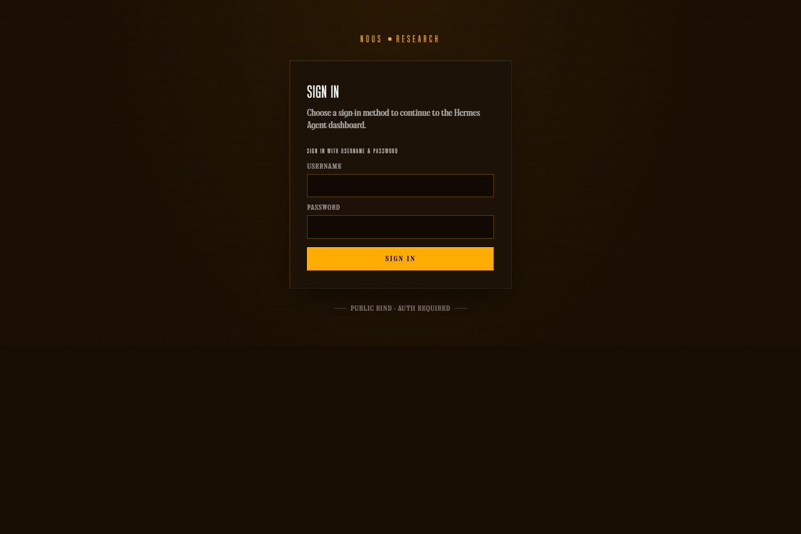
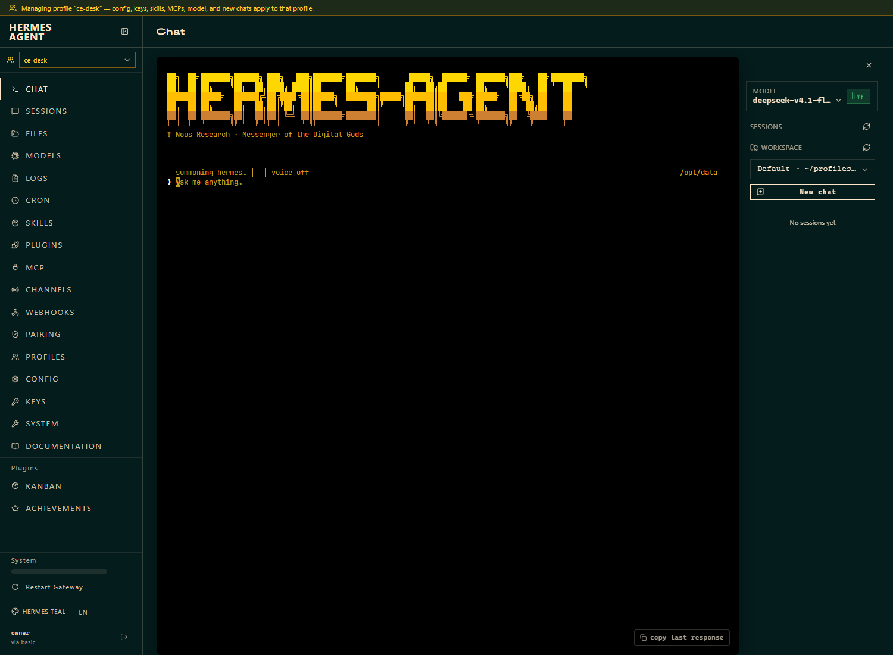

# Deploy RemediGenius CE on a single Spot host (AWS)

This is the current AWS deployment path. It creates one Spot Auto Scaling group
in an existing subnet, runs Hermes and the deterministic collector on that host,
and stores evidence plus private recovery checkpoints in a private S3 bucket.

Use a new Terraform state for this stack. Do not apply it against an old
Lambda deployment's state. Follow [migration instructions](../../docs/UPGRADING.md)
for an existing installation. The [validation record](../../docs/RELEASE-VALIDATION.md)
records the tested package and deployment behavior.

For the equivalent local path, see [Docker workstation](../../docs/LOCAL-COMPUTE-WORKSTATION.md).
For architecture and recovery boundaries, see [single-host migration](../../docs/SINGLE-HOST-MIGRATION.md).

## Before you begin

Use Bash on Linux or WSL2. Install:

- Terraform >= 1.10
- AWS CLI v2 and the AWS Session Manager plugin
- Python 3.11+

You need:

- An **operator/provisioning identity** allowed to create IAM roles, EC2/S3
  resources and the Auto Scaling group. Terraform uses this identity. It is not
  the runtime identity and is not used by the agent.
- An **existing subnet in us-east-1** with outbound HTTPS. The stack creates no
  VPC or NAT gateway. A public subnet needs an Internet Gateway route; a private
  subnet needs suitable egress. No inbound port is opened.
- Your own model account and key for the model provider you intend to use.

The default Spot instance types are `t3.large` / `t3a.large` and Hermes is capped
at 6144 MiB. Leave host memory for the collector, validator and Docker if you
change these values.

## 1. Get the source and package it

```bash
git clone https://github.com/IaCGenius/RemediGenius.git
cd RemediGenius
python tools/package_native_hermes.py --output .rgce/spot-source.zip
```

The packager prints a SHA-256 digest and writes a ZIP. Terraform uploads that ZIP
and verifies its hash at boot. The packager does not read credentials or upload
anything.

## 2. Configure and provision

```bash
cd deploy/aws-single
cp example.tfvars local.tfvars
# Edit local.tfvars: account_id, subnet_id and any optional settings.
terraform init
terraform plan -var-file=local.tfvars
terraform apply -var-file=local.tfvars
```

Variables (see `main.tf` and `example.tfvars`):

| Variable | Required | Notes |
| --- | --- | --- |
| `account_id` | yes | Must match the account the provider signs in as; a mismatch fails the plan. |
| `subnet_id` | yes | Existing subnet in us-east-1 only. |
| `source_zip` | yes | Path to the packaged ZIP, normally `../../.rgce/spot-source.zip`. |
| `name` | no | Stack name, default `rgce`. Used for AWS resource names; runtime container names are fixed within that host. |
| `running` | no | Default `true` starts the Spot instance on first apply. Set `false` and apply to stop it after setup. |
| `spot_instance_types` | no | Default `["t3.large", "t3a.large"]`. |
| `container_memory_mb` | no | Hermes limit, default `6144`; valid range 1024–131072. |
| `public_ip` | no | Default `true`; set `false` for a private subnet with working egress. Private-subnet deployment is not part of the recorded acceptance run. |
| `hermes_ui` | no | Default `true`; enables the optional browser UI. |
| `model_secret_arn` | no | Existing Secrets Manager secret holding only the model API key. |
| `model_name`, `model_base_url` | no | Initial seeds for a new profile. Configure the provider in Hermes for real use. |
| `model_secret_kms_keys` | no | Customer-managed KMS key ARNs for that secret, if used. |
| `delete_data_on_destroy` | no | Default `false`. `true` allows irreversible bucket deletion. |

Do not put the model API key in `local.tfvars`, `example.tfvars` or chat. Only the
secret ARN or the Hermes-side configuration belongs there.

What the stack creates: a private, versioned, TLS-only S3 bucket; a Spot Auto
Scaling group and launch template; a security group with no inbound rules; an
encrypted 20 GiB retained EBS volume; an instance role/profile and an audit role; and starts
the optional UI at boot when `hermes_ui = true`. It creates no Lambda function,
EventBridge schedule, VPC or NAT gateway.

### Identity split

If the dashboard shows **Help improve Hermes? Send to Nous**, choose **No** or
**Skip** to decline upstream feedback. RemediGenius CE collects no adoption telemetry; this
does not change the data sent to your configured model provider.

- **Operator/provisioning identity:** your own credentials, used only for
  `terraform apply` and the SSM session. It never enters the host.
- **Runtime instance role:** the collector uses it through IMDSv2. It attaches
  `SecurityAudit` and `ViewOnlyAccess`, plus narrow `s3:ListBucket`/`s3:GetObject`/
  `s3:PutObject` on RemediGenius CE's own bucket, `ec2:AttachVolume` for the retained volume,
  and `secretsmanager:GetSecretValue` for the exact secret you supplied.
- **Investigation audit role:** assumed by the collector for AWS reads, with
  SecurityAudit/ViewOnlyAccess and explicit credential/body exclusions. A scoped
  session policy limits the requested operation. Host credentials remain separate
  for RemediGenius CE evidence writes and recovery. See [read discovery](../../docs/BROAD-AWS-READER.md).
- **Hermes:** receives no AWS credentials. The Hermes container runs with
  `AWS_EC2_METADATA_DISABLED=true` and requires IMDSv2 (`http_tokens = "required"`,
  hop limit 1). The model cannot call IMDS or widen its access through a prompt.

Terraform state contains infrastructure identifiers and the supplied configuration.
The dashboard login is generated on the host and retained in its private data
volume and S3 checkpoints. Keep state, private inputs and checkpoints protected.

## 3. Start and log in

The first boot builds pinned containers and can take several minutes. Watch
`/var/log/cloud-init-output.log` and the `rgce-native-boot` service through SSM
if it does not become ready.

From the repository root, the helper can show the login privately and open the
tunnel:

```bash
bash tools/open-native-hermes.sh --name rgce --with-login
```

Use your chosen `name`. The helper finds the InService instance from the ASG,
reads `/data/hermes/ce-login.json` through SSM, and forwards the dashboard to
`127.0.0.1:9125`. It does not need a dashboard secret in Secrets Manager. Your
organization's SSM session logging applies. A PowerShell helper
(`tools/open-native-hermes.ps1`) remains a secondary option.

To open the tunnel without displaying credentials:

```bash
aws ssm start-session --region us-east-1 --target i-YOUR_INSTANCE \
  --document-name AWS-StartPortForwardingSession \
  --parameters 'portNumber=9120,localPortNumber=9125'
```

Then, in a separate SSM shell, read the login privately:

```bash
sudo cat /data/hermes/ce-login.json
```

Open `http://127.0.0.1:9125/chat?profile=ce-desk` and sign in. Keep the password
out of chat and screenshots. The optional UI uses remote port 9122; forward it to
another local port and use the same login, then select **ce-desk**:

```bash
aws ssm start-session --region us-east-1 --target i-YOUR_INSTANCE \
  --document-name AWS-StartPortForwardingSession \
  --parameters 'portNumber=9122,localPortNumber=9123'
```

## 4. Configure the model

The tested configuration is a reasoning model with reliable tool calling and
64k+ context, reached through a custom OpenAI-compatible endpoint. RemediGenius CE has been
exercised with DeepSeek v4.1 Flash. Use your own provider account.

Two supported ways to supply the key:

1. **Existing Secrets Manager secret (optional seed).** Create a secret in the
   deployment region whose value is only the raw API key (no JSON, no trailing
   newline). Put only its ARN in `model_secret_arn`. Attach
   `model_secret_kms_keys` if the secret uses a customer-managed key.
2. **Hermes native configuration.** Leave `model_secret_arn` empty and configure
   the provider and key in Hermes after login, using the Hermes Models
   page/config. Keep the custom OpenAI-compatible route (`provider: custom`,
   `key_env: MODEL_API_KEY`) that RemediGenius CE seeds; switching to a native provider can
   require other environment variables the launcher does not inject.

Spot starts the dashboard for model onboarding. Confirm model access with a small
request after configuration; Spot boot does not run the workstation model probe.
A model ID alone does not prove access. Retained Hermes configuration takes
precedence over the tfvars seed, so changing `model_name` later may not replace
an existing profile.

**Without a working model key, RemediGenius CE is not ready to investigate.** The collector
and dashboard still run, but model-backed investigation fails. Never put a key in
a chat message or in tfvars.

## 5. First real question

Ask: `What AWS target can you access? Separate configured access from tested reads.`

Then request one bounded investigation, for example a current Security Hub
findings read or a CloudTrail management-event lookup. The model interprets
deterministic evidence; it does not collect records itself.

## 6. Receipts, knowledge and cases

- **Receipts.** Collection writes raw responses, normalized summaries and a
  receipt to the private bucket under `<prefix>/raw`, `<prefix>/normalized`,
  `<prefix>/receipts` and `<prefix>/catalog.json`. Ask RemediGenius CE to cite the exact
  receipt path and inspect it before trusting a claim. A receipt describes a
  bounded request, not organization-wide coverage.
- **Knowledge.** Ask RemediGenius CE to stage a short organization note with its scope.
  Review the exact Markdown and scope, then send the returned confirmation phrase
  `publish knowledge <id>` in a separate message. Published notes are ordinary
  hashed files under the retained profile and are never treated as AWS facts.
- **Cases.** Use the native Hermes Kanban through the `ce_case` tool. Reads are
  `list`/`show`; `create`, `comment`, `wait`, `verify`, `close` and `archive`
  save local case activity only. There are no cloud changes.

## 7. Persistence

Raw evidence and receipts go to the private versioned S3 bucket during
collection. Sessions, cases, knowledge and model configuration live on the
retained EBS volume and are checkpointed to S3 every two minutes. The restore is
hash-checked and runs before Hermes opens its databases; existing EBS wins.

The two-minute interval is a recovery interval, not zero-data-loss replication.
An abrupt loss can drop activity since the last successful checkpoint. Check
`systemctl status rgce-state.timer` and `rgce-state.service`. Model credentials
can be included in state backups, so protect the whole state prefix. The
model-facing evidence reader cannot read that prefix.

## 8. Stop, back up, remove

Stop compute while retaining data:

```bash
# In local.tfvars: running = false
terraform apply -var-file=local.tfvars
```

Scheduled checks also stop. On restart at most one overdue check runs; missed
intervals are not replayed. Read-only scheduled checks do not call a model.

Back up the Terraform state and the S3 bucket before removal. Then:

```bash
terraform destroy -var-file=local.tfvars
```

By default a non-empty bucket prevents complete removal. The retained session
volume creates a final snapshot when destroyed. Existing model secrets are not
owned or deleted by RemediGenius CE. Setting `delete_data_on_destroy = true` permits deletion
of the bucket and its contents; this is irreversible and only appropriate after
you choose what to retain.

## Screenshots

Actual fresh Spot deployment, 19 October 2026: the native login screen before
credentials are entered. The gateway text says "public bind" inside its container;
the host publishes this port only on loopback, behind the SSM tunnel.



Continue with [login and profile selection](../../docs/WALKTHROUGH.md#2-sign-in-and-select-ce-desk).

Fresh `ce-desk` after login, before the first investigation:



## Optional browser UI

`hermes_ui = true` builds and starts the additional browser UI on remote port
9122. It is a second interface to the same gateway and `ce-desk` profile; the
native dashboard stays available. Use Sessions for conversations and the native dashboard for Kanban. The Bots
panel and skill-category search do not have full parity. See
[the optional UI guide](../../docs/HERMES-UI.md).
