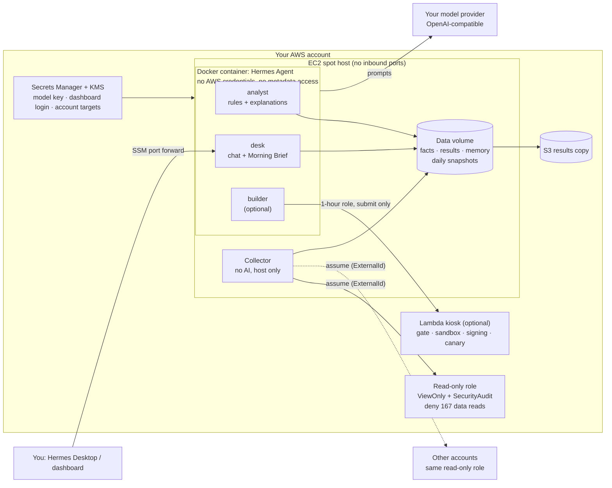

> Historical full-engine / advanced-kiosk guide. This is not the private-preview console installer. Start with [the current quickstart](V0.1-QUICKSTART.md) and [AWS console guide](AWS-WORKSPACE.md).

# Architecture and security model

> This page describes the preserved experimental AWS host deployment. The new
> v0.1 local console is documented in [V0.1-ARCHITECTURE.md](V0.1-ARCHITECTURE.md).
> The console is not wired into this host's boot process. Treat the guarantees
> below as design intent subject to the known gaps, not a production security
> certification. Profiles alone do not isolate a builder from an analyst.

## The idea

**The agent proposes; your cloud enforces.** Every limit that matters is an AWS policy or a platform check, not an
instruction to a model:

- reading is done by a script with no AI;
- deciding is done by fixed rules;
- the AI explains, answers and (with the kiosk) writes code that only a gate can deploy.

## Daily flow

1. **05:00 collector** (host, no AI): for each connected account it assumes the read-only role with that account's
   ExternalId, reads S3, security group and IAM configuration, and writes
   `facts/<account>/<date>/{s3,sg,iam}.json`.
   - Every API call is counted and every error recorded.
   - A call budget caps each run (default 3000).
2. **05:30 analyst job:** runs each check's rules on the facts (deterministic), writes explanations for each finding
   and merges them. Then it validates the result (SkillResult v0: `provider`, `status`, `findings` with `rule_id`,
   `severity`, `evidence`, `fix_id`; annotations limited to `explanation`, `impact`, `next_step`).
3. **07:00 desk job:** the Morning Brief:
   - coverage;
   - what changed since the last run;
   - the top risks;
   - up to 3 decisions for you.
4. **Any time:** you ask the desk agent. It answers only from the results files, using its `results` skill.

The schedule is off until `schedule_enabled = true`. Until then, run the steps by hand (docs/OPERATE.md).

## Where each limit is enforced

| Limit | Enforced by |
|---|---|
| Agents cannot call AWS | Container has no credentials; IMDSv2 hop limit 1 + iptables drop to 169.254.169.254 |
| Reading never returns data | Read-only role: explicit deny on data-plane reads (wins over any allow) |
| Nothing can be changed | Read-only role has no write actions; the host role can only assume roles with that one name |
| A stolen trust cannot be replayed | ExternalId per account + `aws:PrincipalArn` must equal the host role |
| Findings are not invented or re-graded | Rules in `check.py` produce them; `skillresult.py merge` accepts only the three explanation fields |
| No inbound access | Security group with no ingress; SSM Session Manager for shell and tunnel |
| Keys never on disk | Secrets Manager (your KMS key) → tmpfs (`/run/rg-hermes/env`) at boot, refreshed every 6 h |
| Agent code cannot deploy itself | Builder role explicitly denies Lambda create/update/invoke, IAM, signer; only the gate deploys, only signed code (code signing config: Enforce) |
| Agent code cannot reach the network in tests | Sandbox Lambda in a subnet with no route out and a security group with no egress |
| Runaway agents | Kiosk daily caps (3 submissions per version, 20 submissions, 10 promotions, 200 runs), freeze switch, auto-rollback, SNS alerts outside the agent |
| Survives spot interruption | Data volume re-attached on every boot; profiles reconciled from S3 |

## Components and their sources

| Path | What | Note |
|---|---|---|
| `deploy/aws/*.tf` | One Terraform root | 86 resources without the kiosk (most are profile files in S3), about 185 with it |
| `deploy/aws/host/` | Boot scripts and systemd units, synced from S3 at every boot | `boot.sh` is idempotent: `sudo /opt/rg/dist/boot.sh` |
| `onboarding/aws/readonly-role.yaml` | The read-only role | Deny list reviewed action by action against the AWS service reference |
| `profiles/analyst/skills/remedigenius/*` | Three checks + the SkillResult contract | Adapted from jhkchan/aws-agent-skills (Apache-2.0); see each PROVENANCE.md |
| `profiles/builder/skills/kiosk/*` | The kiosk skill + 4 adapted AWS/security skills | Text only from upstream; adapted so the gate deploys |
| `modules/lambda-kiosk` | Reusable module: gate, sandbox, signing, state machines, registry | Works with any agent that can run a CLI |

## Known gaps

- **Shared user id:** all profiles share one user id in one container, so the builder's kiosk credentials file can be
  read by the other profiles. Planned fix: one container per profile.
- **Kiosk agent identity:** the agent name in kiosk run/promote input is not checked against the caller (one agent
  today).
- **Coverage:** three checks only (S3 public access, security group exposure, IAM least privilege), us-east-1 by
  default (`self_regions`, `accounts[*].regions`).
- **Runtime:** Python 3.13 on the host and in the kiosk.
- **Snapshot role:** it keeps `kms:ReEncrypt*`, which the IAM check reports as medium on its own engine.
- **Clouds:** AWS only. Azure and GCP plan: docs/MULTI-CLOUD.md.
