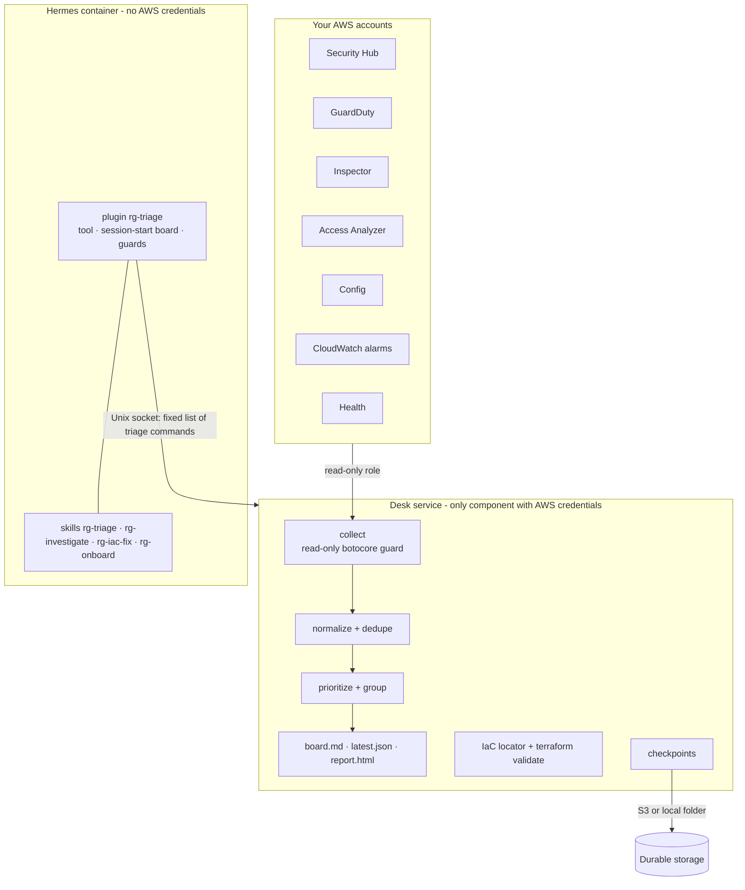

# How RemediGenius Community Edition works

RemediGenius Community Edition (RemediGenius-CE) splits the work in two:

- **Deterministic work**, done by the desk service (`rgtriage`): collecting findings, normalizing, deduplicating,
  scoring, grouping, locating IaC, validating Terraform, saving state.
- **Judgment**, done by the agent (Hermes with the `remedigenius` profile): briefing you, investigating, asking the one
  question that matters, and writing the code change.

No custom agent runtime: Hermes provides chat, the dashboard, skills, memory, schedules and messaging. RemediGenius-CE
adds one Python package, one profile (SOUL, four skills, one plugin) and two deployment paths.

## The agent's surface

| Piece | What it does |
| --- | --- |
| `rg_triage` tool | `digest`, `scan`, `list`, `show`, `fix`, `aws` (one read-only call), `validate`, `decide`, `doctor`, `playbook`, `report` |
| Session-start hook | puts the current board in front of the agent on the first turn; starts a background refresh when the scan is stale |
| Guards | blocks file writes outside the proposals folder; blocks reads of credential stores, keys, `.env` and Terraform state; routes every `decide` through Hermes's approval prompt |
| `/triage` | the board without a model call (interactive chat and gateways) |
| Skills | `rg-triage` (briefing, priorities, decisions), `rg-investigate` (threat triage), `rg-iac-fix` (code location, diff, validation), `rg-onboard` (accounts, context, schedules) |

The Hermes toolsets enabled are `skills`, `clarify`, `file` (repository reading plus writes to proposals) and
`rg_triage`. There is no terminal toolset, so the agent cannot run shell commands.

## Collection and volume

Sources per account and region: Security Hub, GuardDuty, Inspector, IAM Access Analyzer, AWS Config (non-Security Hub
rules), CloudWatch alarms in ALARM, and AWS Health (us-east-1; needs Business support, otherwise its events arrive
through Security Hub). Every source records coverage: `ok`, `not_enabled`, `denied`, `not_available` or `error`.
"No findings" is never confused with "not enabled".

The desk counts everything, reads in detail what can rank high, and shows fixes rather than findings:

| Source | Complete (cheap) | Read in detail |
|---|---|---|
| Inspector | totals plus fix units from `ListFindingAggregations`: AMI, ECR repository, Lambda function, package, CVE | CRITICAL and HIGH up to `detail_limits`, plus MEDIUM with a public exploit |
| Security Hub | — (no count API) | per severity up to `detail_limits`; capped tiers are reported as "at least N" |
| GuardDuty | totals by severity from `GetFindingsStatistics` | up to `max_findings_per_source`, highest severity first |

- Products read directly are excluded from Security Hub queries server-side, so nothing is read twice.
- Only the top `max_stored_findings` (default 20,000) ranked findings are stored. The agent reads a pre-rendered
  board of under 8 KB.
- A newly readable source is a *baseline*, not thousands of "new" alerts. For capped sources, "new" means first
  seen after the previous scan, and nothing is called resolved unless both scans read that source completely.
- `tests/test_rgtriage_scale.py` runs 40,000 Inspector and 3,000 Security Hub findings through the CLI in about a second.

## Prioritization

Score = source severity (CRITICAL 60, HIGH 45, MEDIUM 25, LOW 10; vulnerabilities get 75%) plus signals, each written
into the finding's `reasons`:

| Signal | Points |
|---|---|
| Threat detection; compromise/exfiltration/impact types | +10 / +20 |
| Root credentials used (by call volume) | +15 / +25 / +40 |
| Public exposure (exposure controls, Access Analyzer public, network reachability) | +15 |
| Exploit available / EPSS ≥ 0.1 / fix available | +12 / +5 / +3 |
| Detection or audit gap (Config.1, CloudTrail.*, GuardDuty.1 …) | +8 |
| Toxic combination: more than one risk type on the same resource | +10 |
| One fix (AMI/image/function rebuild) clears ≥100 / ≥1,000 findings | +5 / +8 |
| Business criticality (account, application tags, env tag) | −10 … +15 |
| Matches a stated business goal | +5 |
| Threat with no activity for 30+ days | −10 |

P1 ≥ 70 (act now), P2 ≥ 50 (this week), P3 ≥ 30 (backlog), otherwise P4. Findings that share one fix collapse into
one issue: the same control across standards, one package across many CVEs and instances, and all 14 CIS CloudWatch
metric-filter controls. Decisions (acknowledged, investigating, fixing, accepted_risk, false_positive, suppressed,
resolved) hide or annotate issues; they are local triage records and do not change AWS.

## IaC fixes

`fix` indexes Terraform (variables, `.tfvars`, local `.tfstate` ids), CloudFormation/SAM templates and CDK output, then
ranks candidate code by evidence:

- **high**: a CloudFormation logical-id tag or Terraform state id equals the resource, or a literal name matches
- **medium**: a resolvable name pattern or prefix matches
- **low**: the same resource type with a computed name, which the agent must confirm
- **none**: not in the indexed code, or an account-level control that needs a new resource

It also lists the blocks that configure the resource (for example `aws_s3_bucket_public_access_block`) and loads the
remediation playbook. The agent writes a diff, saves it to the proposals folder and runs `validate`
(`terraform init -backend=false`, `validate`, `fmt` on a scratch copy; no plan, no apply, no AWS credentials).

## Durable state

`rgtriage/durable.py` checkpoints two homes, the Hermes home and the desk state, to S3 (Spot) or a local folder
(workstation):

- consistent copies of live SQLite databases (online backup); per-file SHA-256 manifest; the pointer is written last
- unchanged homes are skipped; 10 snapshots kept per home
- restore happens only into an empty home and verifies every hash. Live state always wins.
- **lineage**: a home may only replace checkpoints it descends from. A fresh machine whose restore did not run is
  refused (`DIVERGED`) instead of overwriting good state.
- triggers: every 2 minutes, after scans and decisions, on service stop, and on an EC2 Spot interruption notice

## Concepts borrowed from the AWS Well-Architected Agent

| Well-Architected Agent | RemediGenius-CE |
|---|---|
| Agent profile: accounts, Regions, goals | `triage.yaml`: accounts, regions, `goals` with optional boosts |
| Execution role + read-only access role per account | audit role / member read roles with `SecurityAudit`; automatic discovery at every scan; `rgtriage onboarding` |
| Application context: tags and criticality | `applications` (tag match → `mission_critical` … `test_development`), `environment_tag_keys` |
| Goal-aligned prioritization | criticality and goal boosts in the score, shown in the reasons |
| Ready-to-deploy IaC with trade-offs | diff, `terraform validate`, blast radius and rollback; you apply it |
| Scheduled refresh | scan timer plus a session-start refresh when stale; `security-watch` alerts |
| Builds on existing services | the AWS security services above are the sources; no custom detectors |
