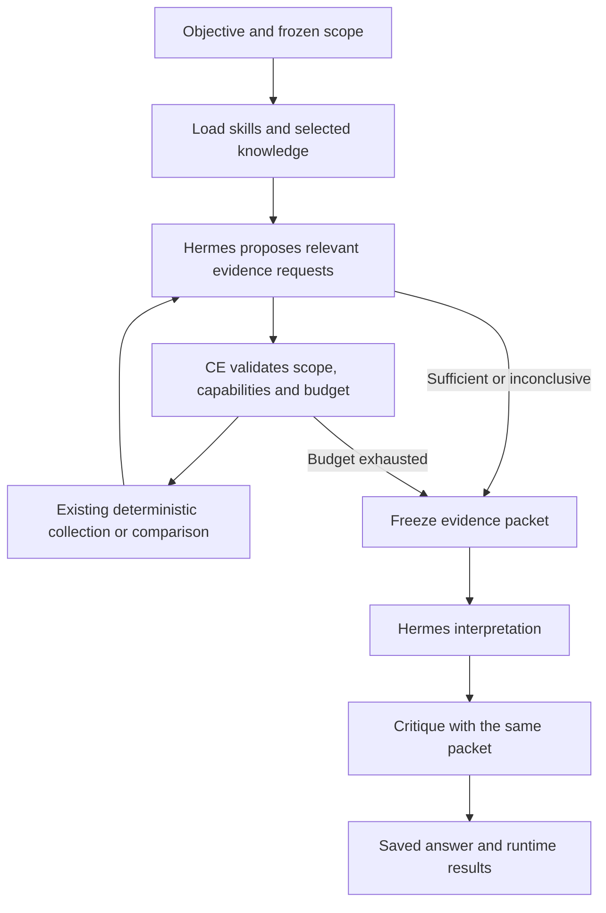

# Predetermined process, flexible investigation

Implementation candidate, not yet promoted to the published release or Spot deployment.
The native tool retains the name `ce_assessment`. It now accepts security objectives
and findings, not a mandatory AWS source checklist.

## User experience

Ask a question, supply a finding or select existing evidence. Establish the account
aliases, region (us-east-1), objective and completion criteria. Optionally select
organization knowledge documents and prior evidence/run IDs. Hermes starts one
investigation and returns its ID. Continue that ID, show saved results, or cancel.
A turn-budget pause preserves progress; a blocked run never automatically restarts.

Examples: investigate an imported alert; reconcile conflicting observations; explain
instance inventory; assess a concern using available sources; compare baseline/current
snapshots. Broad AWS posture is another objective, not a required source sequence.

## Control flow

CE owns stages and stopping. Hermes chooses schema discovery, scoped reads,
projections of supplied/returned evidence, or comparison of known snapshots.
Every request must address an evidence gap. Generated collectors, shell commands,
scope expansion and arbitrary tool installation are prohibited. Existing Lambda/IAM
boundaries remain. An active investigation blocks independent CE calls in its chat.
Final rendering uses the saved answer rather than an outer-model rewrite. Native
UI behavior, including streaming, still needs acceptance testing.

## Limits

| Control | Default |
|---|---|
| Investigation rounds | 3 maximum |
| Requests per round | 3 maximum |
| Total actions | 12 maximum |
| Live AWS reads | 6 maximum |
| Requested pages | One per read; 6 maximum overall |
| Invalid-plan repairs | One per investigation |
| Reasoning call | 60 seconds; 2,000 output tokens |
| Context packet | 120,000 characters maximum; block rather than silently truncate |
| Hermes outer turn | 24 steps / 480 seconds by default; includes skill loading and workflow hops |

Repeated identical requests are rejected. A denied operation cannot be retried by
changing parameters. Budgets survive turns. Interrupted in-flight hops block rather
than replay. A file lock prevents concurrent advance; abandoned locks require inspection.

Evidence sufficiency is an AI judgment, distinct from process completion. The controller
proves stages ran, not that every security conclusion is correct. Inconclusive outcomes
retain what was learned and what evidence is missing.

The outer chat allowance must accommodate the workflow's stages; it does not increase
the collection budgets. A RUNNING pause resumes the same ID. BLOCKED is terminal:
report the saved failure, correct its cause, and start a new investigation only when
the operator requests one. Compact progress replies omit full evidence text; the
controller's saved packet remains available to its reasoning and review stages.
The chat execution gate redirects direct live reads and comparisons into this workflow
before dispatch. Saved-evidence inspection, schemas, help and fix validation remain
available outside an active investigation. This applies across admitted AWS services.

## Knowledge and skills

The controller loads ce-investigation, AWS-read, security and knowledge skills directly.
Planning requests a short structured decision; interpretation handles the final report.
Interpretation and critique receive the same frozen packet and hash. Partial collection
and display truncation remain explicit. An index is not the full policy: select exact
knowledge document paths when their content matters.

Findings, logs, tags and knowledge are untrusted data, not execution instructions.
Synthetic fixtures stay labelled synthetic. Conflicts without reliable chronology remain
unresolved. Organizational exceptions do not rewrite AWS facts or source severity.

## Storage and remaining boundaries

Private records live at `$HERMES_HOME/ce-assessments/<id>.json` on the retained profile
volume; AWS collection evidence remains in S3. Records contain private knowledge/evidence.
Automatic S3 backup of investigation records is not implemented. Losing the retained
volume is different from Spot replacement.

Fix preparation and artifact validation use the existing capabilities after
investigation, including when requested in the same chat turn. The frozen investigation
answer remains visible; validator results and requested case activity appear as a
separate follow-up. This does not apply
remediation. Reassessment can invoke the existing comparator with known baseline/current
run IDs. No LangGraph or second model credential store is required.

Local boundary tests and isolated real-model evaluations do not replace native
UI, registered-plugin and deployment acceptance.
