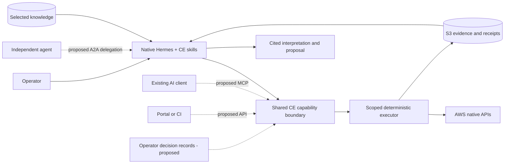

# What RemediGenius CE adds, and how it should grow

Reviewed against the repository on 2026-10-14. **Implemented** means present in
the native Hermes candidate; **preserved** means older code exists but is not
connected to that runtime; **proposed** means a design, not a shipped endpoint.
See [acceptance results](CE-RUNTIME-ACCEPTANCE.md) for what was actually tested.

## 1. The offering beyond third-party Hermes

**CE turns existing AWS security data into an evidence-backed investigation,
organization-specific explanation, actionable proposal and repeatable reassessment.**
Hermes supplies the agent runtime. CE supplies the security operating workflow.

| Layer | What the user gets | Ownership / present status |
|---|---|---|
| Conversation, sessions, model routing and skill loading | Native agent experience and choice of model provider | Third-party Hermes; pinned official container, not our LLM or fork |
| AWS security procedures | Readable investigation skills, source interpretation, coverage limits and proposal guidance | CE profile plus attributed upstream reference material |
| Runtime enforcement | Package checks, known account/region/operation scope, request limits, denied-operation stop, bounded critique | CE native plugin; permissions do not depend on the model following a prompt |
| Cloud collection | One reusable SDK executor rather than a new script per question; separate read identities | CE Lambda, IAM and operation manifest |
| Evidence | Original responses, defined deterministic summaries, observation times, hashes and receipts in S3 | CE evidence contract; inspectable independently of Hermes |
| Shared knowledge | Selected Markdown/metadata collections for ownership, policies, runbooks and scoped variations | CE library/view tooling and knowledge skill; operator owns content |
| Reassessment | Repeat the same request and compare source snapshots | CE comparator; changes are not proof of remediation |
| Deployment and recovery | Spot runtime, separate disposable collection, retained session volume and source pins | CE infrastructure and operating instructions |

The differentiator is the combination: **existing tools → trustworthy collection
→ shared context → useful investigation → proposed action → observed reassessment**.
The model still makes interpretation mistakes. The critic is advisory, not a
certificate; evidence and permissions remain independently inspectable.

CE is Apache-2.0 source. Hermes and incorporated references retain their own
licenses/attributions; see [LICENSE](../LICENSE), [NOTICE](../NOTICE) and skill
PROVENANCE files. Self-hosted does not mean free AWS compute, storage or model use.

## 2. What is expandable today?

| Extension | Current position | Required work / boundary |
|---|---|---|
| Another reasoning or utility model | Hermes configuration; `ce_review` is a native auxiliary task | Operator configures credentials/model; test the provider's actual behavior |
| More knowledge | Import source documents, build a selected view, publish/mount it | Preserve provenance and applicability; changing knowledge grants no tool permissions |
| More accounts/regions | Explicit target configuration and member read role | Deploy trust/permissions in each account; no automatic organization-wide rollout |
| Another supported AWS operation | Generic executor already discovers SDK input schemas | Update operation/IAM manifest, review and test; arbitrary SDK calls are not admitted |
| Additional skills | Native Hermes mechanism; CE core instructions are integrity checked | Review core changes and repackage. Extra instructions cannot bypass admitted tools |
| Additional plugins/MCP tools | Hermes extensions are possible in principle | Current gate blocks unadmitted tools. Installation alone is not authorization |
| Azure/GCP | Architecture can be reused | New identity/executor/provider skills and real tests are still needed; AWS code is not a multi-cloud adapter |
| Events/scheduled reassessment | Proposed for this workflow | Add bounded scheduling, durable job records, deduplication and fresh collection; no continuous-watch claim today |

Keep cloud collection, storage and decision records outside the conversational
runtime. A different runtime should be able to use the same evidence without
migrating knowledge into model memory. Skills explain how to work; IAM and the
execution boundary determine what can run.

## 3. Integration standards: skills, MCP, API and A2A

These solve different problems. They should share one CE capability contract,
not grow four independent implementations.

| Interface | User's need | Current native CE status |
|---|---|---|
| Readable skills | Teach an agent the workflow and meaning of results | Implemented; skill portability does not itself provide tools or credentials |
| MCP | Let an existing AI client discover and call CE capabilities | Proposed native bridge; older read-only MCP server preserved separately |
| HTTP API | Let portals, CI jobs and automation submit work and retrieve results | Proposed native service API; older console API preserved separately |
| A2A | Delegate an investigation to another independently running agent and track its task/artifacts | Not implemented; do not claim A2A compliance |

MCP describes callable tools and retrievable resources. A2A provides agent
discovery and task/message/artifact concepts. An A2A Agent Card's advertised
skills are capabilities, not the same artifact as a local `SKILL.md`. Use official
SDKs and pin supported protocol versions when implementing; neither protocol
supplies CE's authorization or evidence semantics automatically.
Sources: [MCP tools](https://modelcontextprotocol.io/specification/2026-07-28/server/tools),
[MCP resources](https://modelcontextprotocol.io/specification/2026-07-28/server/resources),
[A2A specification](https://a2a-protocol.org/latest/specification/).

Recommended order: stabilize the shared contract and operator decisions, expose
MCP plus a small API, then add A2A when a real independent-agent consumer needs it.
No new proprietary agent-to-agent protocol is needed.

Solid paths describe today's broad workflow; dotted interfaces/decision store
are proposed. Today's gate lives in the native plugin. An external bridge must
reuse/extract its enforcement deliberately, not directly invoke its internal
handler or expose admission tickets.

## 4. Proposed MCP tools and HTTP API

Two consumption modes: **bring your own agent** calls deterministic tools and
interprets evidence itself; **delegate to CE** asks Hermes to investigate and
returns explicitly model-generated proposals. The first need not make CE model
calls. The second incurs model cost and remains subject to CE execution limits.

The following names/routes are a proposed public contract, not deployed URLs.

| MCP tool | HTTP equivalent | Result / side effects |
|---|---|---|
| `get_capabilities` | `GET /v1/capabilities` | Authorized scopes, operations, schemas, limits and implementation status; not proof all sources work |
| `collect_evidence` | `POST /v1/collections` | Bounded provider/service/operation/parameters request; source read, but creates CE records and can incur cost |
| `get_run` | `GET /v1/runs/{id}` | State, coverage, errors, receipt and artifact references |
| `read_evidence` | `GET /v1/runs/{id}/artifacts/{artifact}` | Authorized bounded projection/excerpt and source hash; never arbitrary filesystem/S3 access |
| `read_knowledge` | `GET /v1/knowledge/views/{view}/documents/{id}` | Selected context, provenance, scope and freshness; no whole-library exposure by default |
| `compare_runs` | `POST /v1/comparisons` | Deterministic changed/unchanged/incomparable and limitations; no model needed |
| `start_investigation` | `POST /v1/investigations` | Hermes task ID for question, explicit scope and budget; may collect and call models |
| `get_investigation` | `GET /v1/investigations/{id}` | Evidence references, AI interpretation, proposals, review status and unresolved gaps |
| `cancel_investigation` | `POST /v1/investigations/{id}/cancel` | Stop further dispatch; cancellation is not rollback or a promise to stop provider billing instantly |
| `propose_disposition` | `POST /v1/disposition-drafts` | Proposed false-positive/expected-activity/accepted-risk decision; no authority to activate it |
| `explain_disposition` | `GET /v1/findings/{id}/disposition` | Applied decision, exact match basis, expiry and revalidation state |

An authenticated **operator** interface would additionally support
`POST /v1/dispositions` to activate a reviewed revision and
`POST /v1/dispositions/{id}/revoke`. These change CE presentation/decision data,
not AWS. They are not general autonomous-agent tools. One CE operator may draft
and confirm; a separate approval committee is unnecessary. Do not invent an
operator confirmation from a model's statement that approval happened.

Use MCP resources for immutable receipt/evidence references and selected knowledge;
optional prompts can offer “first AWS assessment” and “explain this decision.”
MCP tool annotations describe behavior, but server-side authorization must enforce it.
Collection/investigation tools must not be advertised as side-effect-free reads.

API responses should carry a version, request/run ID, actual account/region scope,
observation time, producer (source/deterministic/operator/model), pagination,
coverage/errors, artifact hashes and model-review status. Preserve native finding
severity separately from suggested priority. Do not represent API success as
security success. Use OpenAPI/JSON Schema; keep original AWS ASFF/other records
and their source schemas rather than pretending all evidence is one standard.

For longer work, return an accepted task ID and support polling; add events only
when needed. Persist task state before claiming restart-safe jobs. Enforce scoped
caller identities, server-side account mappings, input validation, rate/budget
limits, idempotency for submission, and artifact authorization. A caller cannot
supply an arbitrary role ARN or broaden its scope through a prompt. Never return
model keys, cloud credentials or unrestricted object-storage links.

### What already exists but must not be confused with this design

[The preserved MCP server](../rgce/mcp_server.py) exposes `list_capabilities`,
`list_assessments`, `list_evidence`, `get_record`, `search_knowledge_sources`,
`investigate`, `prepare_proposal`, `reassess`, `list_knowledge_concepts` and
`prepare_knowledge_review`. Its investigation/proposal tools retrieve deterministic
legacy-store context/templates; they do not delegate to the deployed Hermes agent.
It uses stdio, not a deployed remote CE MCP endpoint.

[The preserved FastAPI app](../rgce/app.py) includes assessment, proposal,
reassessment, document, knowledge and local Hermes job routes. These belong to
the earlier console. Their presence does not mean the native cloud candidate
serves the proposed `/v1` API. Reuse reviewed components, not the old console as
an accidental second agent brain.

## 5. A new AWS account: useful before there are findings

The first outcome should be **“what can we observe, what protections are present,
what needs attention, and what remains unknown?”**, not an invented posture score.

1. **Connect and establish scope.** Operator deploys CE and its read roles, selects
   accounts/regions and optionally supplies purpose, owner and environment context.
   Preflight confirms reachable execution and configured capabilities. It does not
   certify account posture. No administrator credentials go to the agent.
2. **Discover existing protection.** In bounded turns inspect relevant Security Hub,
   GuardDuty, Inspector, CloudTrail, Access Analyzer and Config metadata. Distinguish
   configured, readable, populated and current. Ten services cannot all be explored
   within the default six-cloud-read turn budget; present a staged plan.
3. **Inspect actual resources.** Use allowed EC2 network and S3 configuration reads
   for selected resources, plus available findings. Empty findings may mean missing
   services, missing permissions, no evaluated resources or genuinely no returned
   findings. Each explanation needs evidence; never call an empty account secure.
4. **Return a short improvement backlog.** For each item show observation, source,
   coverage, affected resource, reason, next step, owner if supplied, uncertainty
   and a verification method. Separate setup gaps from detected vulnerabilities.
5. **Operator makes the change.** CE can explain a proposal and checks to perform;
   the current read-only runtime cannot enable services, apply Terraform or fix IAM.
   Paid service activation and telemetry retention remain explicit operator choices.
6. **Reassess.** Repeat compatible reads. Source refresh may lag a real change;
   timestamps changing alone are not a fix. Independently check the target control
   where a supported API exists, otherwise state what verification is missing.

Root-account protection, federation, temporary credentials and least privilege
belong in new-account guidance. However, today's manifest has no general IAM
credential-report/root-MFA inventory operations. CE can explain these checks or
interpret relevant Security Hub evidence; it cannot claim direct verification
without a connected source. See [AWS IAM guidance](https://docs.aws.amazon.com/IAM/latest/UserGuide/best-practices.html)
and [root-user guidance](https://docs.aws.amazon.com/us_en/IAM/latest/UserGuide/root-user-best-practices.html).
Likewise, recorder configuration is not recording status, and Security Lake
metadata is not a lake query. These are current coverage gaps, not hidden passes.

Suggested first request: “Review this new account in small stages. Start with
security-source availability, then relevant resource exposure. Show observed,
unknown and not-assessed separately, and give my next three actions with receipts.”

## 6. False positives, repeated findings and organization exceptions

**Recommendation: reduce noise in CE first, while continuing to collect source
evidence.** An operator decision is a separate record, not a rewrite of AWS facts.
This lifecycle is proposed; the current native skill interprets supplied exception
documents, but does not implement deterministic suppression or automatic reopening.

| Operator meaning | Decision kind | What it must not imply |
|---|---|---|
| “The reported condition is wrong; here is evidence” | False positive | No blanket waiver for similar-looking findings |
| “This action is expected in this specific context” | Expected activity | Not necessarily a detector error |
| “The condition is real, but we accept it temporarily” | Accepted risk / policy exception | Not a false positive and not remediated |
| “This is another representation of the same issue” | Duplicate/grouping | Do not drop source IDs, counts or evidence |
| “We changed it and verified the result” | Remediated with verification evidence | Operator assertion alone is not verified remediation |

### The simple operator experience to build

The user says “This is expected for this application.” Hermes drafts a readable
decision: **what matches, why, who asserted it, evidence, review/expiry date and
what invalidates it**. The operator reviews and confirms that exact revision.
Default to this finding/resource; broader matching requires explicit scope.
Show “operator-classified expected activity” rather than asserting objective safety.

Store Markdown plus validated metadata in a separate S3 decision prefix. Keep
versioned revisions and a decision-use receipt per assessment; mutable indexes
may point at immutable revisions. Plain files should remain inspectable. Edit
source through the operator workflow and republish; avoid directly editing generated
views/hashes. This extends the simple library, not a new knowledge bureaucracy.

Minimum proposed metadata: decision ID/revision, kind, exact provider/account/
region/resource/control or finding-type selectors, baseline/policy version if
applicable, reason, supporting receipt references, operator identity, confirmation
time, effective/review/expiry dates, match-rule version, required evidence fields
and invalidating conditions. Never treat an LLM-generated owner name as authentication.

### Repeats and posture change

Use ProductArn + Id to identify a Security Hub finding instance. Recurring issues
may get new IDs: a separate, versioned issue match can use provider, account,
region, resource identity, control/type and relevant condition. Text similarity
can suggest a match for review; it must not silently create suppression scope.
Start with exact matches, not an opaque similarity score or account-wide wildcard.

| New observation | Proposed deterministic disposition behavior |
|---|---|
| Exact scope/conditions still match; decision current; required evidence fresh | Group repeat in “acknowledged”; retain occurrence count and latest receipt |
| Only source refresh timestamps or pagination metadata change | Keep the decision if all security-relevant predicates still hold; record refresh |
| Exposure, principal, resource incarnation, environment, severity, condition or supporting protection changes | Mark decision NEEDS_REVIEW and bring finding back to attention |
| New resource/type, even if its wording is similar | New finding; no automatic carryover |
| Decision expires, is revoked, its policy changes, or relevant knowledge conflicts | Stop applying it; show why and request review |
| Collection is denied, partial, stale or lacks a required predicate | Cannot revalidate; show UNKNOWN/NEEDS_REVIEW, not a quiet or remediated result |
| Finding disappears | Check query coverage, archival/deletion and source latency; disappearance alone is not a fix |

Use three-valued matching: match, no match, unknown. Predicates must name actual
required data; an uncollected protection cannot satisfy a condition. Semantic
matching ignores documented volatile fields only, not security-relevant changes.
This matcher is different from today's comparator, which correctly reports all
finding-field changes, including timestamps. Do not quietly alter that comparator's
meaning to implement noise reduction.

An illustrative scenario, **not an observed customer finding**: a legacy workload
has a temporary accepted-risk decision conditional on private reachability and
an exact workload identity. If it becomes public, moves to production, or current
reachability cannot be established, CE must resurface it. An expected scan similarly
does not cover a new principal, target or activity outside its confirmed scope.

Both human and agent should receive the same explanation: original severity,
operator decision and reason, matching scope, last validation, expiry, occurrence
count, and the precise reason it resurfaced. Offer an “include acknowledged” view;
do not hide unreviewed or unknown results. A scheduled/event-driven version needs
durable triggers and deduplication; today reassessment is user-triggered.

### CE decisions versus AWS suppression

Security Hub workflow changes apply to findings; suppressing one does not prevent
new findings for the issue, and a suppressed finding does not automatically return
to NEW merely because RecordState becomes ACTIVE. Do not rely on that status as
CE's posture-change detector. [AWS workflow semantics](https://docs.aws.amazon.com/securityhub/latest/userguide/findings-workflow-status.html).

GuardDuty suppression automatically archives matches and affects downstream
delivery and attack-sequence correlation. Source-side suppression can therefore
remove signals CE would otherwise consume. If used externally, coverage must say
which archived/direct-source records were actually queried; never promise CE can
detect every change in data no longer delivered to it.
[AWS GuardDuty suppression](https://docs.aws.amazon.com/guardduty/latest/ug/findings_suppression-rule.html).

The CE executor currently exposes no AWS suppression/write operation. A later
AWS-write integration must be separately authorized and audited. The bundled
upstream AWS skill reference also discourages suppression recommendations; before
shipping a CE disposition workflow, document the deliberate CE-local behavior and
resolve conflicting reference instructions explicitly. Do not imply this document
has already changed the running skill or cloud policy.

## 7. What to reuse and what to implement next

Reuse the operation schemas, IAM boundary, receipt format, comparison helper,
selected knowledge library and native Hermes provider routing. The preserved
[knowledge resolver](../rgce/knowledge.py) contains exact-scope, dependency and
conflict concepts worth adapting; it is not a production native suppression engine.
Avoid importing its entire legacy approval UI into the agent workflow.

Recommended next increments:

1. Publish this honest capability boundary and a repeatable new-account playbook.
2. Add operator-owned decision records and deterministic applicability/revalidation
   for exact matches. Test expiry, changed exposure, new resource identities,
   missing evidence, duplicate delivery and contradictory knowledge with receipts.
3. Expose the shared read/collection/comparison contract through one tested MCP/API
   bridge. Verify that external callers get the same scopes, limits and provenance.
4. Add persisted scheduled/event-triggered reassessment; prove Spot interruption,
   replay and duplicate events cannot lose a decision or silently skip work.
5. Add A2A discovery/delegation when needed, with scoped task input, bounded runtime,
   durable status, evidence artifacts and explicit input-required/cancellation paths.

All proposed steps need implementation and acceptance evidence before marketing
them as available. This document adds product and interface design; it does not
modify the deployed runtime, grant new permissions or change the tested bundle.
