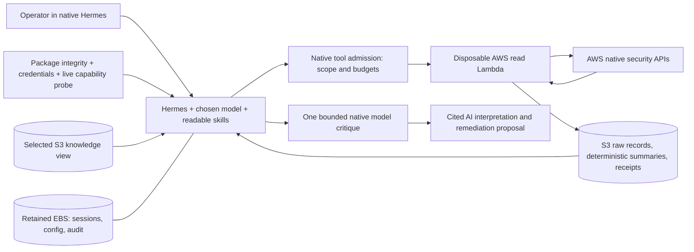

# Native CE execution contract

Implementation candidate; live acceptance is required before publication claims.
Hermes remains the agent and owns its UI, sessions and model-provider configuration.
CE contributes one native plugin, readable skills, and a separate AWS read executor.

The model chooses investigation steps; the admission gate and Lambda decide what
can execute. The critic cannot grant execution rights or alter source records.

## Before an investigation

The plugin checks reviewed package hashes, active core skill/SOUL hashes, temporary
credential expiry, and a real capabilities call to the executor. The resulting
environment context includes UTC time, configured account aliases/regions,
operations and budgets. READY does not assert every AWS service is accessible.
An integrity, credential or connectivity failure blocks CE tool admission.

The default investigation toolset is skills, clarification and ce_runtime. The
plugin admits only skill viewing/listing, clarification and the three CE tools.
Terminal, arbitrary file access, skill editing, and unreviewed plugin tools are
blocked. Scope is also independently checked by Lambda and IAM. The plugin and
helper package are mounted read-only; there is no fork of Hermes.

## Three reusable tools

| Tool | Purpose |
|---|---|
| ce_aws | SDK schema discovery, scoped reads, exact S3 evidence projection and comparison |
| ce_knowledge | Bounded Markdown/JSON reads inside the operator-selected knowledge view |
| ce_review | One model critique of an answer draft against the actual retrieved evidence |
| ce_case | Native Kanban cases and local activity/closure records; no customer cloud writes or worker dispatch |

`policy.json` contains operator settings: 24 admitted tool calls, 6 cloud reads,
at most 2 identical requests, and a 240-second deadline for admitting new calls
per turn. An already-running request may finish after that deadline; it has its
own subprocess/SDK/Lambda limits. Access denied stops that operation in that scope
for the turn. One review call is allowed, with a 60-second requested model timeout
and 1,600 output-token limit. Provider-internal retries still follow native Hermes.
This is not a dollar ceiling. Operator policy changes require repackaging and vetting.

The review uses Hermes's current model/provider credentials through its native
plugin LLM API. There is no hardcoded Qwen transport or new credential store.
`policy.json` names the pinned fix/follow-up references supplied to the critic;
these are bounded packaged guidance, not cloud evidence. Tool excerpts carry
their tool names and arguments, and the current preflight is included. Missing
context can still require a fresh evidence read; a critique remains advisory.
Review may be disabled in policy. A final label distinguishes AI_CRITIQUED,
NOT_GROUNDED (no evidence excerpts) and NOT_REVIEWED. None certifies correctness, approves remediation, or
guarantees that the main model applied the critique. Native streaming may expose
draft text before final transformation; the label is not a pre-display guarantee.

## Deterministic evidence

The executor preserves source records, normalizes defined fields and writes hashes
and receipts to S3. CloudTrail normalization includes decoded API errors and
identity data; malformed event bodies remain explicitly unknown. Security Hub
reassessment compares findings by ProductArn and Id, excluding transport tokens
and page ordering. Partial/failed or incompatible reads are INCOMPARABLE.
Other services retain explicitly labelled response-level comparison semantics.

Knowledge is operator-supplied context. It can alter suggested business priority,
not AWS facts or source severities. Missing knowledge remains not supplied, not
proof the organization has no policy. No new approval committee is introduced.

## Persistence and review

Evidence and published knowledge remain in S3. Hermes sessions, configuration and
`logs/ce-runtime.jsonl` remain on retained encrypted EBS. Audit entries record
preflight status, admission denials, tool outcomes and run IDs without raw document
content or secrets. Native session traces hold the conversation and tool results.
There is no S3 backup of the entire Hermes session volume in this implementation.

On Spot replacement the pinned source package is restored read-only. Existing
profiles and user model configuration are preserved. If core instructions no
longer match the package, preflight blocks and an explicit upgrade is required.
Run `tools/upgrade_native_profile.py` inside the pinned container as the profile
owner with `--home /opt/data/profiles/ce-desk`, then restart the gateway. The script
backs up files and preserves model settings; use a maintenance window.

Additional plugins are executable trusted operator code. Merely installing one
does not admit its tools to CE. Review its runtime, identity and permissions,
test it, then explicitly update the admitted capability package. The operator can
use unrestricted Hermes separately, but that is outside this CE execution contract.

## Boundaries of the claims

IAM, operation validation, tool admission, hashes and budgets are deterministic.
Choosing the right investigation, interpreting events and judging a proposal
remain model-dependent. A reviewer is assistance, not a second authority over
permissions. Missing capability results must be surfaced rather than replaced by
agent-written execution code. Builder/remediation execution remains separate and
is not enabled by this read-only CE profile.

## Utility-model configuration

The plugin registers `ce_review` as a native Hermes auxiliary task. It inherits
main-provider routing by default. Operators can select a separate utility model
through Hermes's auxiliary configuration without editing CE provider code.
CE calls `ctx.llm.acomplete` under an async total deadline; a timeout or empty
critique is NOT_REVIEWED, never a silent success. Cancelling the local request
cannot guarantee a provider immediately stops its remote billing/work.

The shipped `auxiliary.ce_review.reasoning_effort: none` keeps the critique short.
The main model reasoning setting is unchanged; the upgrade preserves an existing
operator choice for this utility slot.

The critic receives the configured capability manifest and retained collection
facts separately from display snippets. A truncated display does not make the
underlying AWS collection incomplete. Display text is bounded with explicit
truncation flags; the complete draft is preserved or review is refused. Critique
is advisory: source facts and configured capabilities take precedence.

The review packet also carries exact read arguments, execution limits and the
number of reads used. It contains bounded same-session excerpts retained across
turns, with tool names/arguments and current preflight context, not the entire
conversation. A claim referring to omitted or older evidence may therefore be unverifiable
to this critic; that does not make it fabricated. The agent must reconcile a
critique against receipts rather than blindly accept it. The runtime supplies one
review-status heading. AI_CRITIQUED means a critique was returned with excerpts, not that every
claim passed or that an independent reviewer approved the proposal.

## Reuse in the hosted product

The native plugin, readable skills, SDK operation manifest, evidence comparator
and S3 receipt format are reusable independently of a CE console. A hosted version
can compose them with separate analyst/builder identities and an independently
approved execution boundary. Keep its IAM roles, prefixes and deployment state
separate; do not merge CE test evidence into production knowledge. No hosted
repository changes or automatic remediation were made as part of this release.
