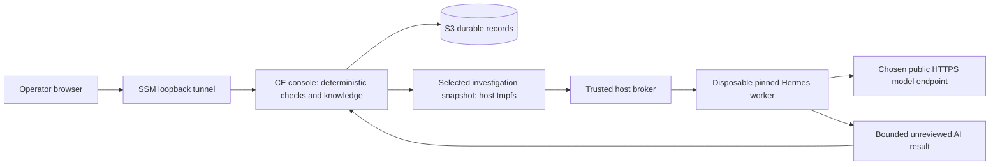

# Hermes-powered Community Edition in AWS

This deployment is separate from the local CE preview and from RemediGenius v2. The CE console, deterministic evidence and knowledge handling, and Hermes investigations belong to one community release. Hermes runs as a disposable worker behind the console, not as another product or a manual export requirement.

The infrastructure lives in [`deploy/aws-hermes`](../deploy/aws-hermes/main.tf). It uses one Spot Auto Scaling Group, an existing private S3 bucket/prefix, an exact model-secret ARN, and two independently pinned Docker image archives. It does not create or modify the v2 engine. Terraform validation is a configuration check; deployment and live acceptance must be recorded separately before claiming this runtime is release-ready.

## What runs where



The console owns S3 persistence. It runs with the narrowly scoped host role and listens on host loopback. Hermes receives only the selected snapshot and model configuration, with no AWS credentials, instance role, Docker socket, or console token. The host broker launches workers; the console cannot launch arbitrary containers. The broker must validate request paths, limit time/output, and remove completed or timed-out workers.

The host reads the one permitted Secrets Manager secret as a raw API key, then safely constructs root-only `/run/rgce-hermes/model.env` in tmpfs. A Python helper combines that key with the non-secret model settings and rejects whitespace, newlines, control characters and oversized keys; it never evaluates shell text. The existing secret is read-only and is not modified. Do not put its value into Terraform variables, plans, images, user-data, or Git. The worker necessarily receives the model credential to call the chosen provider. The console is not given that envfile. The trusted host role can retrieve the secret; this is process separation, not separation from a compromised trusted host or privileged console.

## Durable state and interruption

Only S3 records are durable. Instance disks, model envfiles, per-job snapshots and agent scratch space are disposable. The console must persist an investigation request before it queues a job and persist the result after validation. An interrupted investigation must be shown as interrupted/retryable; an interrupted model call cannot be resumed or reported as successful merely because the instance returns. Retrying may incur another model call.

The ASG uses Spot exclusively, maximum one instance, no capacity rebalance, and stop-before-start refresh settings to reduce replacement overlap. These settings are not a distributed writer lease or fencing protocol: use exactly one deployment for each workspace prefix, and prove that the previous writer has terminated during replacement testing. Replacements can be unavailable when this subnet's Spot capacity is exhausted. This is a small single-operator CE deployment, without high-availability or multi-writer guarantees. Scaling to zero stops compute but retains S3 storage and the secret, which may continue to cost money.

## Network and IAM boundaries

- No inbound security-group ports. Use Systems Manager port forwarding to host port 8765.
- IMDSv2 is required with hop limit one and IPv6 metadata disabled.
- Worker bridge `rgce-agent` has no published ports. Host INPUT rules reject traffic from that bridge to host services. DOCKER-USER first permits TCP/UDP port 53 **only to the IPv4 DNS resolvers configured in the host's `/etc/resolv.conf`**, then rejects private, link-local and special-use destinations, then permits public outbound TCP 443. Docker's embedded DNS forwards through this narrowly scoped DNS exception. This is not unrestricted private-network access; metadata HTTP and the host console remain blocked. DNS queries themselves can carry information, so these rules are not an exfiltration-proof network sandbox.
- Worker containers must drop capabilities, use a nonroot UID and read-only root, and receive only their own read-only snapshot plus scratch tmpfs. The bridge controls remain host-managed.
- HTTPS egress permits public model endpoints generally; it is not a provider-domain allowlist. A malicious model/tool with network capabilities would need stronger egress proxy policy. The CE worker therefore exposes the bounded file investigation toolset, not arbitrary networking or shell tools.
- Host IAM allows only the selected workspace prefix, two exact image objects, conditional append-only S3 writes, SSM host management and the exact model-secret ARN. Optional customer-managed secret KMS decrypt is scoped to that key and secret encryption context. It does not give the agent general AWS read or write access.

## Configure and deploy

Build and test the console and pinned Hermes images first. The console image must contain `/usr/share/rgce/hermes/broker.py`; an old rc9 console image cannot provide the new runtime. Upload both `docker save` archives to the selected bucket, record each archive SHA256 and Docker image ID, and supply those pins in a private tfvars file. Public templates contain no account identifiers or secrets.

Required inputs: `account_id`, `region`, `subnet_id`, `bucket_name`, a new `workspace_prefix`, `console_image_key`, `console_archive_sha256`, `console_image_id`, the corresponding three `hermes_*` fields, and `model_secret_arn`, `model_name`, `model_base_url`. `model_provider` defaults to `custom`; `model_key_env` defaults to `OPENAI_API_KEY`. Use a dedicated `name`; set `running=true` when ready. `associate_public_ip=true` requires a subnet with an Internet Gateway route; set it false only with appropriate outbound NAT/VPC connectivity. The default x86 host is `t3.medium`; both images must be Linux amd64. An existing SSE-KMS S3 bucket needs additional explicitly reviewed key permissions; this template's S3 path assumes SSE-S3.

```powershell
terraform -chdir=deploy/aws-hermes init
terraform -chdir=deploy/aws-hermes validate
terraform -chdir=deploy/aws-hermes plan -var-file=C:/private/ce-hermes.tfvars -out=ce-hermes.tfplan
terraform -chdir=deploy/aws-hermes apply ce-hermes.tfplan
```

Inspect the plan before applying. Keep state and tfvars private. Find the active instance using the `autoscaling_group` output and start an `AWS-StartPortForwardingSession` SSM session with remote port `8765` and a free local port. Opening the local tunnel does not deploy or connect the existing workstation preview.

To stop, set `running=false` in the same private tfvars and plan/apply. Do not merely stop the EC2 instance: its ASG would replace it. Do not delete the S3 prefix to stop compute. To update either image, record new pins and apply a reviewed plan; ASG refresh will replace the host while retaining S3 records.

## Model configuration and operator consent

The initial operator deployment reuses the existing Bailian raw-key secret through its exact ARN, with the existing model name and HTTPS base URL supplied in private tfvars. No key is copied into the repository and no upstream secret is edited. Investigations start only when the operator selects the evidence and requests a run with the required consent. Deployment starts the broker but does not schedule model calls or enable an assessment timer.

The broker passes `RGCE_MODEL_PROVIDER`, `RGCE_MODEL_NAME`, `RGCE_MODEL_BASE_URL` and `RGCE_MODEL_KEY_ENV` to the worker alongside the API key under the chosen environment variable. The worker uses Hermes' existing provider support. The key-variable selection is restricted to API-key-style names and excludes AWS and RGCE namespaces.

DeepSeek is an alternative configuration, not an enabled provider or fallback yet. When the operator supplies its key, store it as a separate raw-key secret and switch the exact secret ARN, selected DeepSeek model name, HTTPS API base URL and `model_key_env = "DEEPSEEK_API_KEY"`. Leave those values unset rather than inserting fake keys. Select the Hermes provider identifier supported by the pinned runtime (`custom` for its compatible endpoint path); do not silently fall back or send an investigation to a second provider on failure. This option requires a separate real-provider acceptance test before it is advertised as verified.

The worker cannot reach host metadata, but the trusted host-network console shares the EC2 role with the secret-fetching broker. Therefore the console could retrieve that exact model secret even though its normal process environment does not contain the key. This design does **not** claim IAM separation between those trusted components. Independent identities would require a separate broker host/task or a scoped credential proxy; neither is provided by this single-host CE stack.

## Acceptance before sharing

See [rc10 cloud acceptance](RC10-CLOUD-ACCEPTANCE.md) for actual results and outstanding checks.

Verify the actual pinned images, model identity, and Hermes upstream revision. Run a selected synthetic investigation through console → persisted request → broker → real Hermes/model → persisted result → console. Check citations, deterministic-versus-AI labels, cancellation/time limits and provider failure. Attempt metadata, host-console and private-network access from a worker and prove denial; prove ordinary model HTTPS works. Terminate the dedicated test instance and verify replacement recovers knowledge and completed results without reporting interrupted jobs as successful. Finally scale the ASG to zero and record the exact versions, results and remaining storage. Simulated adapters alone do not satisfy these acceptance checks.
