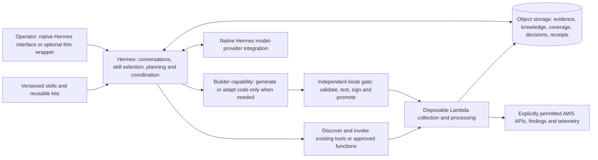

# CE architecture correction — Hermes is the brain

Date: 2026-10-13. Status: design reconciliation following the owner's rejection of the rc10 architecture. **This is the corrected direction, not a claim that it has been implemented.** No running deployment was changed during this review.

## What went wrong

The rc10 CE made a custom Python/browser workspace the orchestrator and gave Hermes a selected snapshot with two read-only tools. That is a useful bounded investigation mode, but it does not deliver the owner's Hermes-led security operating model. Passing infrastructure and model-call tests did not establish product alignment. Describing rc10 as the intended CE release was wrong.

The source repository already records this distinction. `docs/EXPLORATION.md` says the owner rejected the conventional connect/check/report portal on October 9 and wanted light working agent sketches before hardening. The October 8 assessment MVP and ENGINE.md deferred Hermes; the later Hermes sketch, operating model and kiosk documents put profiles and skills at the centre. Those older MVP constraints must not silently govern this CE redesign. The owner's current instructions take precedence over either historical track.

## The corrected product

A self-hosted security agent built around upstream Hermes. The operator talks to Hermes through its native interface. Hermes discovers what capabilities and evidence exist, selects skills, plans an investigation, obtains missing information through permitted tools and compute, consults shared knowledge, and returns a supported answer or actionable proposal. A small optional wrapper may display the same conversations, capabilities, approvals and results; it must not become a second workflow engine.

This is a **target** overview. The existing v2 work supplies many parts, but not a complete end-to-end CE implementation of this picture. Fargate fallback, full knowledge refresh and general reader-kit integration must not be implied by this diagram.

## Responsibility boundaries

| Responsibility | Owner in the corrected architecture |
|---|---|
| Understand the question, plan, select skills, correlate and explain | Hermes and the selected model |
| Describe a security mission or procedure | Readable skills, references and reusable scripts |
| Find existing capabilities before building | Hermes using a capability/function registry and existing tool documentation |
| Repeated AWS collection or telemetry processing | Reusable tools or disposable functions, with narrowly scoped runtime roles |
| Create a missing utility or collector | Builder capability through the kiosk; not a new custom browser route for every use case |
| Durable shared knowledge and evidence | Versioned object-storage files and receipts, readable by humans and tools |
| Exact counts, fixed rule severity, coverage, hashes and budgets | Small deterministic helpers; these do not dictate every investigation step |
| Execution rights, compute limits and promotion policy | IAM and the independent kiosk gate; agent-generated code cannot enlarge its own authority |
| Conversation, profiles, sessions, provider setup and supported scheduling | Reuse Hermes; do not replace these with CE-specific orchestration |
| Presentation for people who dislike the native interface | Optional thin wrapper over the same runtime and capabilities |

The intent is **less custom product machinery**, not pretending that durable writes, identity boundaries or function deployment need no code. New ordinary missions should normally be skill/content changes or reuse of a registered tool, not application migrations and an expanding suite of screen-specific tests.

## Shared brain: knowledge, memory and storage

Shared knowledge must be available to Hermes during investigation, not only preselected by a browser form. A knowledge skill should retrieve current relevant context, show source receipts, preserve scoped variations and dates, identify missing context, and refresh derived summaries when their sources change. Reuse CE's document conversion, provenance and applicability logic where useful as helpers. Do not force a full custom UI or bespoke knowledge server to use them.

Keep source evidence, organisational assertions, reviewed exceptions and generated analysis distinct. An agent can draft and revise knowledge with the user's chosen review policy; it cannot silently turn an inference into an observed fact. Do not invent environment labels to make a rule apply.

Object storage owns durable evidence, knowledge versions, function registry entries, run status and decisions. A small index/catalogue lets Hermes discover what exists and what is stale. Local copies are rebuildable working files. The earlier operating model explicitly calls for index, coverage and run receipts so the desk does not answer from stale chat memory.

Hermes conversation/session state is a separate persistence concern: the v2 implementation used EBS with snapshots and S3 copies. An object-storage-first CE still needs a coherent checkpoint/restore strategy for native session state. Do not mount S3 as if it were a live SQLite filesystem or claim that this migration is already done. Preserve working v2 state until a real restart/recovery journey proves the replacement.

## Dynamic compute: reuse the kiosk

The v2 kiosk separates platform, skill pack and kits. Its workflow is: search the registry → reuse a suitable function → otherwise build from a kit → test/submit → gate/sign → canary/promote → run → save outputs/receipts → reuse. Within an already authorised execution class and promotion policy, the agent should not need a human to deploy every function. New permissions, targets or higher limits remain owner decisions.

Building a collector and running an approved collector are different capabilities. Builder code goes through the gate. Runtime functions receive a fixed execution class and bounded input; they do not receive general deployment or IAM authority. Collections are reads against the selected sources, while the platform necessarily writes its own output objects and deploys its own compute.

Reuse existing AWS-native findings, SDK/CLI support and approved functions before generating code. The user may enable bounded S3-object or CloudWatch-log reads: older configuration-only policies are a baseline, not justification to silently deny the newer requested telemetry features or silently grant broad data access. Discovery should report exactly which permissions and sources are available.

## What is actually available to reuse

| Existing work | Treatment |
|---|---|
| v2 Hermes gateway and desk/analyst/builder profiles | Starting point for the agent experience; inspect installed-version behaviour and isolate authority by capability |
| Existing `profiles/` and `skills.lock.json` in CE | Reuse the preserved skill distribution and provenance rather than recreate it |
| v2 / CE Lambda kiosk module, CLI, skill and kits | Reuse gate/signing/registry/run machinery; prove the selected collection path |
| v2 K0/K1 builder demonstrations | Historical evidence of a real Hermes builder creating/updating/running functions; not proof that every planned kiosk class exists |
| v2 K2–K5, general reader kit, Fargate fallback and wider healing design | Treat as incomplete until code and real execution establish otherwise |
| CE `modules/approved-reader` | A separate fixed-reader implementation to reuse or adapt, not proof that the general kiosk reader class is complete |
| CE S3 persistence, evidence receipts, document conversion, scoped knowledge and rule helpers | Salvage as small CLI/library capabilities accessible to skills |
| CE browser console and snapshot worker | Preserve as optional viewer / bounded investigation mode; remove from the architectural centre |
| CE broker and two-tool runner | Reuse useful isolation lessons; do not make this restricted worker the only Hermes experience |
| CE read-only MCP server | Optional compatibility surface over existing capabilities; not a prerequisite or a replacement brain |
| Terraform/IAM/read-role templates, pinned runtimes, operating notes | Reuse with separate CE names/state; keep v2 parked and intact |

## Existing gaps we must not carry forward invisibly

The v2 runbook records that profiles shared a UID and could read builder credential files; caller identity was not fully bound to the declared agent name. Reusing profiles alone therefore does not provide role isolation. Reuse their content, but keep investigator and builder authority in independently isolated execution contexts. The documented host collector actually ran as a host service, rather than Hermes no-agent cron, because the host held collection authority.

The older kiosk demonstrates K0/K1 processor generation, not a complete general AWS reader. Coverage/index/run-receipt completion, desk delivery, per-tenant analyst separation and K2–K5 remain separate gaps. The current CE fixed approved-reader module may shorten one path, but it does not make those gaps disappear. Revalidate only the boundaries and real journeys needed for the chosen first experience.

## Skills, CLI, API and MCP

Skills are the primary workflow surface: what to do, what tools are available, what evidence to retrieve and how to interpret the receipts. Tool implementations remain reusable CLI/library/platform capabilities rather than prose claiming to enforce permissions.

For another agent, offer the same skills plus readable object/file interfaces and CLI access. Optional MCP can expose the same catalogue, evidence/knowledge queries and bounded actions when needed; it must not duplicate logic. The current CE MCP is local stdio with read-only tools, not a deployed remote gateway and not an API to the native Hermes runtime. Any future remote exposure needs an actual authenticated integration; it is not implemented by renaming the existing server.

Keep upstream Hermes pinned and separately upgradeable. Prefer profiles, skills and supported interfaces over a fork. Investigate the installed runtime's native facilities before adding wrappers; the v2 notes are implementation evidence at a particular version, not a promise that all later versions behave identically.

## Smallest aligned demonstration

1. Start a separate CE native Hermes experience using the existing profile/gateway approach. The owner talks to the agent directly; no mandatory custom dashboard.
2. Ask what it can inspect. Hermes reads configured capabilities, permissions and coverage instead of inventing an inventory.
3. Ask one useful question against an explicitly selected real AWS source. Hermes chooses an existing skill/tool and launches bounded collection or processing through the existing compute path. Report actual data or the precise unavailable capability.
4. Save output and receipts to object storage. Add genuine owner-supplied knowledge and show how Hermes retrieves it in a second question. Missing context remains unknown.
5. Where a capability is genuinely missing, show the builder reusing a kit and the kiosk accepting or rejecting the generated function. Prove a real run and later reuse without manually adding a new application workflow.
6. Replace compute and ask about the previous run. Hermes must discover the retained data and coverage, not rely on a remembered answer. Only then assess whether an optional wrapper would help.

Evaluate these few real journeys and the small set of permission, cost, persistence and provenance boundaries. Keep useful existing regression tests; do not make test counts or endless helper tests the definition of success. Generated code may use local test inputs during development, but do not represent those as observed AWS facts or a successful live collection. The demonstration must be understandable to the owner before more hardening or broader platform work.

## Primary design evidence

Paths below refer to the read-only reviewed repository `C:/work/the prior internal prototype`.

- `docs/EXPLORATION.md`, October 9 entry: explicit rejection of conventional portal and sketch-first direction.
- `docs/ideas/2026-10-09-continuous-autonomous-security-assurance.md`: agents investigate and present decision cases; living security context.
- `docs/ideas/2026-10-09-decisions-and-25-use-cases.md`: pull baseline, account questions, existing native tools, action adapters; missions as skills.
- `docs/ideas/2026-10-10-hermes-sketch-plan.md`: native Hermes interface; desk + analyst + collector; skills loaded on demand; later optional portal.
- `docs/ideas/2026-10-11-hermes-operating-model.md`: skills, shared files/index/coverage, native scheduling/hand-offs, agent behaviour checks, state separate from compute.
- `docs/ideas/2026-10-11-lambda-kiosk.md`: explicitly “Hermes is the brain. The kiosk is the hands”; registry-first reuse, generated functions, enforcement outside the model; K0/K1 versus K2–K5 status.
- `docs/ideas/2026-10-12-community-edition-and-hosted-models.md`: CE as read-only role, collector/rules, kiosk and self-host engine kit, bring-your-own model. This review does not revalidate that document's legal or provider-terms claims.
- `docs/HERMES.md`, `infra/hermes/RUNBOOK.md`, `infra/hermes/PROVISIONED.md`: actual implementation, parked state and gaps; distinguish these from design diagrams.
- `docs/MVP.md`, `docs/ENGINE.md`, `docs/adr/0009-engine-hermes-hidden.md`: older deferred-engine assessment track, not the current CE product direction.

The review also covered the other idea documents, skill-review/deep-dive notes, core architecture/playbook/threat/handover/state/work-package documents, ADRs, and the work-packet objectives. Generated diagram HTML/PDF copies were treated as supporting renditions; their textual designs and diagram source inventory were used rather than treating pictures as implementation proof.

## Review coverage and preservation

Reviewed all 48 Markdown documents under the v2 `docs/` tree: 13 top-level documents, 12 idea papers/reviews, 22 ADR/index files and the diagram index. Scanned objectives and scope for all 25 work-packet YAML files. Also reviewed root project/provenance notes, the three Hermes infrastructure guides and the kiosk module README. Two review passes cross-checked vision against operational status. Generated HTML/PDF duplicates were not independently executed; no current AWS-state verification or current provider-terms research is claimed.

The rc10 implementation, original diagram and engineering acceptance remain preserved in Git. They describe what was built, not an accepted implementation of this revised direction. No files in `the prior internal prototype` or `the prior internal prototype` were edited; no runtime, model key, AWS role or deployment was changed for this review.
