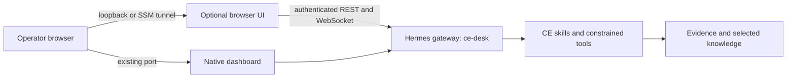

# Optional Hermes browser UI

RemediGenius CE can serve [przbadu/hermes-ui](https://github.com/przbadu/hermes-ui) alongside
Hermes's native dashboard. It is an additional chat interface to the **same
Hermes gateway and ce-desk profile**, not a second agent. The native dashboard
remains available. This is optional; it does not change RemediGenius CE's AWS permissions.



## Workstation

First complete the normal [workstation setup](WORKSTATION-HERMES.md). In your private
workstation JSON set `"hermes_ui": true` and `"ui_port": 9126`. Start with the
normal workstation launcher. Open http://127.0.0.1:9126. The native dashboard
keeps its configured port (normally 9125).

To add the UI to an already running workstation without restarting Hermes:

```bash
python tools/native_ui.py start --name rgce-workstation --port 9126
```

Use your configured container name if different. Docker builds the pinned UI on
first use; allow several minutes, Internet access and approximately 3 GiB free
build memory. The running frontend has a 128 MiB limit. Build cache consumes disk.
No Node/Bun installation on the operator's machine is required.

## AWS Spot

Set `hermes_ui = true` in your private `deploy/aws-single` tfvars before packaging
and deploying the normal source ZIP. Review the Terraform plan. The boot path
builds/starts the UI after the existing gateway and profile are ready. The setting
is included in the source/configuration used for Spot replacement. Evidence and
sessions remain in their existing S3/EBS locations.

Forward the additional loopback port (keep this terminal open):

```bash
aws ssm start-session --region us-east-1 --target YOUR_INSTANCE_ID \
  --document-name AWS-StartPortForwardingSession \
  --parameters 'portNumber=9122,localPortNumber=9123'
```

Open http://127.0.0.1:9123. The native dashboard still uses remote port 9120.
There are no new security-group ingress rules or IAM permissions.

## Login and use

1. On first visit, the UI redirects to the native gateway login. Use the **same dashboard username/password**, obtained through the normal
   workstation `login` command or the Spot host's retained `ce-login.json` through SSM. Never paste a
   model key into chat. The gateway handles authentication.
2. Select **ce-desk** in the UI profile selector, then open or create a session. The optional UI does not use the native dashboard's `?profile=ce-desk` URL parameter. Confirm the profile before sending context.
3. Ask a question, inspect the tool cards, and continue with follow-up questions.
   For example: “List our shared knowledge,” then “Open the encryption rule.”
4. Use the original dashboard for controls whose parity is not verified below.

The UI receives no mounted credentials, AWS environment variables or Hermes data
volume. It proxies authenticated gateway requests through a dedicated internal
Docker network. Like the native dashboard, it is an operator interface, not a
restricted multi-user portal. The authenticated gateway can expose administrative
features; do not share the operator login or publish these loopback ports.

Routed Hermes profiles use profile-scoped secrets. On first UI setup the helper
seeds `MODEL_API_KEY` from the existing gateway environment into ce-desk's private
`.env` (0600), only if absent. It does not print the key or rotate it. An existing
profile value is preserved. When rotating the model key, update that profile's
private secret too; replacing only the launcher's environment is insufficient.

## What has been verified

Live Spot tests with Hermes v0.21.7 / DeepSeek v4.1 Flash verified chat, RemediGenius CE
capabilities, skill discovery/loading, shared-knowledge index and document reads,
review calls, session listing and conversation recovery after refresh. Tool and
session database records confirmed ce-desk routing. These are functional checks,
not proof that every answer is correct.

Known limitations: the Bots panel can remain loading; use Sessions. Skill category
search can return no results while listing/loading skills by name works. A review
may not receive every outer tool result. Attachments do not automatically become
shared organizational knowledge. Kanban changes, scheduler changes, uploads,
model switching and full AWS/remediation workflows have not been qualified through
this UI. Keep the native dashboard available. No claim of complete UI parity.

## Native dashboard interaction notes

The native Chat page is a terminal view. The optional UI is a graphical chat
view of the same agent. They do not have identical navigation or rendering.

- Use **New chat** for a new conversation; confirm that the context is fresh
  before sending unrelated work. Reopening a saved conversation retains context.
  In the terminal, `/new` opens a confirmation dialog. Select **Yes, start a new
  session** (or use its displayed **Y** shortcut). Typing `/new` alone does not
  clear the current context.
- The native Chat side panel lists recent activity. In the pinned upstream
  version, the separate Sessions page requests creation order; an older resumed
  session can appear farther down. This remains an upstream UI limitation.
- **Gateway running** describes the server process, not the browser's terminal
  connection. A disconnected banner needs attention even if the gateway is up.
- A native **Response** heading can precede additional tool activity. Use the
  completed investigation result and terminal **ready** state to distinguish
  final delivery from intermediate output; the heading alone is not completion.
- If the localhost page cannot connect, check that its SSM port-forward process
  is still running. Restart the tunnel with the same remote/local ports from the
  setup guide, then refresh. Do not delete sessions or restart the server merely
  because the local tunnel closed.
- For long answers, the optional UI provides a graphical transcript and tool
  cards. In native Chat, closing the right panel and refreshing can recover a
  reported redraw problem. This workaround is not a claim that every upstream
  terminal-rendering issue is fixed.
- Open manual Kanban from its dashboard plugin entry when available, use
  `/kanban` in native Chat, or use the supported case prompts. Plugin navigation
  can differ between interfaces.

New RemediGenius CE setup selects `ce-desk` as the active profile. Upgrades keep
an explicitly selected, existing operator profile. Unrelated bundled skills are
disabled by default; their files remain available for deliberate operator use.

## Stop, recovery and source

```bash
python tools/native_ui.py stop --name rgce-workstation
```

This removes only the RemediGenius CE-owned UI container; it retains the image/network and
all Hermes data. Workstation `stop` also stops the UI. On Spot, set `hermes_ui =
false` for subsequent boots; stopping the UI alone does not stop Hermes. A build
failure should be fixed before enabling the optional UI; the native gateway is
started first and remains the recovery interface.

Source: `deploy/hermes-ui/` and `tools/native_ui.py`. Upstream is pinned to commit
`1af684e2d6ce05e6d1da82d67bc671e15d2d2d96`. Its MIT license is retained in
`deploy/hermes-ui/UPSTREAM-LICENSE`. RemediGenius CE applies one small, checked patch: preserve
the selected profile in cookie-ticket and token WebSocket URLs. If the upstream
connector changes, the build fails for review rather than silently skipping the
patch. The final nginx image is digest-pinned; no upstream backend is installed.
