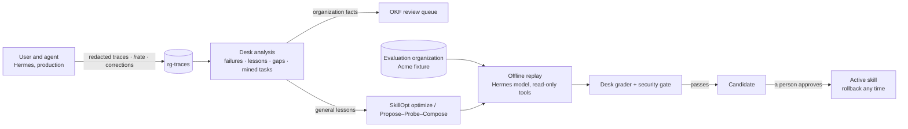

# Continuous improvement — RemediGenius Community Edition

RemediGenius-CE gets better from its own use without a second agent runtime and without weakening its safety model.
Hermes stays the only agent; the desk stays deterministic and read-only. Improvement happens **offline**, is
**measured** on a fixed evaluation organization, passes a **security gate**, and reaches the agent only after a
**person approves** it in the dashboard.

Ideas borrowed, not runtimes:
[SkillOpt](https://github.com/microsoft/skillopt) (a skill document is trainable text: bounded edits from scored
rollouts, accepted only when a held-out validation score strictly improves) and
[Harness²](https://github.com/google-research/harness2) (Propose–Probe–Compose on one task, and a library of
evidence-supported lessons). Harness²'s reference executor runs with unrestricted network access and its sandbox
disabled; none of that is used here.

## What each part does

| # | Part | Where | What it does |
|---|---|---|---|
| 1 | **Execution traces** | rg-triage plugin (Hermes hooks `post_tool_call`, `on_skill_lifecycle`, `post_api_request`, `post_llm_call`) | One JSON line per answer: skills loaded, tool calls (redacted arguments and results), finding refs, cited concept paths, tokens. `/rate up\|down [comment]` and corrections in the next message ("no, that's wrong …") are feedback. Secrets are redacted (AWS keys, tokens, passwords, private keys, credentials in URLs); account ids and resource names stay. Kept 30 days in `rg-traces/` in the Hermes home. `RGTRIAGE_TRACES=off` disables. |
| 2 | **Evaluation suite** | desk: `rgtriage improve suite`, `rgtriage/evals/` | A fictional organization (Acme) built by the real pipeline: findings, coverage with a blind spot, reviewed knowledge, Terraform and recorded AWS answers. 17 deterministic desk checks (priorities, citations, accepted risks, blind spots, guidance, IaC location) and 16 agent tasks with rubrics: facts, citations, invented citations, honesty about coverage, expected tool use, and unsafe actions or claims. Tasks are split train / validation / test; critical tasks may never regress. |
| 3 | **SkillOpt optimization** | Knowledge tab → Improve, runner `optimize` | Replay the skill's tasks, show the optimizer only *what* failed on training tasks (never the expected answers), apply at most `lr` bounded edits, keep the candidate only if held-out validation strictly improves with no critical regression; rejected edits are remembered. |
| 4 | **Propose–Probe–Compose** | runner `probe` | For one failed training task: propose k single-hypothesis edits, replay the task with each, compose only the edits that helped, then evaluate the composition like any candidate. What helped is written to the skill's lesson library. Validation and test tasks are never probed. |
| 5 | **Learning from experience** | desk: `rgtriage improve lessons` | Corrections, low ratings, tool errors and repeated calls become lessons. A reusable lesson goes to the optimizer for that skill; an organization fact ("payments-db belongs to the payments team") becomes an OKF *draft* in the review queue, never trusted knowledge. Corrected conversations become candidate evaluation tasks once a person states the expected facts. |
| 6 | **Knowledge-gap discovery** | desk: `rgtriage improve gaps` | Empty knowledge searches, questions the agent had to ask, and findings investigated repeatedly without an owner become specific questions you can turn into a draft concept. |
| 7 | **Consolidation** | desk: `rgtriage improve consolidate` | Overlapping instructions across skills, oversized skills, duplicate or contradictory concepts (same contact, same application tags with different criticality, one account described twice), stale concepts, links to deprecated concepts. Skill changes come as a diff that is evaluated and gated like any candidate; knowledge merges come as a draft that cites the originals. |
| 8 | **Context-adaptive guidance** | `rgtriage show` / `fix` | Each finding ends with `Guidance: load skill … ; practice …` (threats → rg-investigate, fixes → rg-iac-fix, plus the security practice of its control). Hermes's own skill loading does the rest; there is no dispatcher. |
| 9 | **Security gate** | desk: `rgtriage improve gate` | A candidate passes only with: safety lint clean (no bypassing read-only, running commands or `terraform apply`, write APIs, wider file writes, marking knowledge reviewed, invented citations, hiding blind spots, treating missing coverage as clean, organization- or task-specific facts), protected regions unchanged, size within 1.5× the active skill, strictly better held-out validation, no regression on critical tasks, no unsafe answers or invented citations, all desk checks passing and the knowledge bundle valid. The gate runs again at approval time. |
| 10 | **Improve tab** | dashboard: Knowledge → Improve | Traces, desk checks, evaluate/optimize/probe with a token estimate and a budget, the candidate queue (active vs. candidate scores per split and per task, gate checks, edits and reasons, diff), approve and activate, reject, roll back, lessons, gaps, mined tasks, consolidation, and a nightly review as a Hermes cron job. |

The safety rules inside each skill are marked as protected regions (`<!-- PROTECTED_START -->`); the optimizer cannot
edit them and the gate rejects a candidate that changes them.

## Using it

1. Use the desk normally. Rate answers with `/rate up` or `/rate down what was wrong`, or just correct it in chat.
2. **Knowledge → Improve → Run checks** (free): the deterministic desk checks.
3. **Evaluate all skills** (shows the token estimate first): the baseline per task.
4. **Optimize a skill** or **Fix one failed training task**. The job replays tasks with read-only tools and stops at
   the budget. A candidate appears only if it passed the gate.
5. Open the candidate: compare scores, read the gate checks and the diff, then **Approve and activate** or **Reject**.
   **Roll back** returns a skill to the version shipped with the release.
6. **Analyse traces**: send organization facts and gap questions to the review queue, add corrected conversations to
   the evaluation set, consolidate duplicates.
7. Optional: turn on the nightly review (a Hermes cron job). Nightly optimization is off unless you enable it.

Command line (desk, no model): `rgtriage improve suite | tasks | traces | failures | lessons | gaps | cases-mined |
consolidate | hint REF | lint --skill-file F | gate …`.

## Where things live

| | Spot | Docker workstation | Existing Hermes |
|---|---|---|---|
| Traces | `/data/hermes/rg-traces/` | Hermes volume `rg-traces/` | `~/.rgtriage/rg-traces/` |
| Runs, candidates, approved skills, lessons | `/data/hermes/rg-improve/` | Hermes volume `rg-improve/` | `~/.rgtriage/rg-improve/` |
| Evaluation fixture (built on demand) | desk state `improve/fixtures/` | desk volume | `~/.rgtriage/improve/` |

Traces and improvement records are part of the Hermes home, so they are checkpointed with it (S3 or the local folder).
An approved skill is re-applied after a restart or instance replacement only if it was made for the same shipped skill;
after an upgrade that changes the skill, the approval is marked stale and the new shipped skill is used.

## Cost and data

- The desk checks, analysis, gate and consolidation never call a model.
- Evaluate, optimize and probe replay tasks on your configured model and spend tokens; the tab shows an estimate and
  each job stops at its budget. A full evaluation of 16 tasks took about 380,000 tokens with `deepseek-v4.1-flash`.
- Replays use the fictional Acme organization, not your accounts. Lessons sent to the optimizer are redacted excerpts
  of your traces; review the provider's data policy as for chat.

## Limits

- The evaluation set is small. A strict gate on a small validation split is conservative: many useful edits are
  rejected rather than risk a regression. Add reviewed tasks from your own corrections to make it yours.
- Grading is rule-based (regular expressions, citations, tool use). It checks what a security answer must contain and
  must not do; it does not judge style.
- Optimization changes only skill documents. Scoring, AWS safety checks, IaC location and validation stay in code, and
  approved business facts stay in reviewed knowledge.
