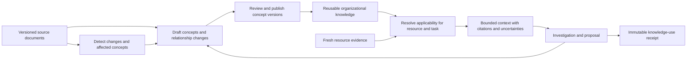

# Knowledge foundation: reuse, applicability and refresh

Implementation update: rc3 implements the first reusable-concept lifecycle, exact
applicability, versioned reviews, manual refresh propagation and knowledge-use
receipts. See [the operational guide](KNOWLEDGE-QUICKSTART.md) for tested scope and
remaining limits. The design below records the broader target architecture.

Design decision, 2026-10-12. Proposed architecture; not a claim of implemented
OKF support. This supersedes the interpretation of knowledge variations as only
risk-acceptance exceptions in KNOWLEDGE-USE-AND-EXCEPTIONS.md.

## What we borrow

[Karpathy's LLM Wiki](https://gist.github.com/karpathy/442a6bf555914893e9891c11519de94f)
contributes the pattern of preserved sources, persistent linked synthesis,
maintenance conventions, and ingest/query/health-check workflows. We adapt this
with reviewed promotion of decision-bearing statements; agent edits stay drafts.

[Google's OKF v0.2 article](https://cloud.google.com/blog/products/data-analytics/okf-v0-2-adds-trust-signals)
explains provenance, trust, freshness, lifecycle and computation attestation.
These are signals and conventions, not an organizational policy engine.

The [canonical specification](https://github.com/GoogleCloudPlatform/open-knowledge-format/blob/main/SPEC.md)
uses Markdown with YAML frontmatter. Adopt its `sources`, `generated`, `verified`,
`status` and `stale_after` fields and preserve unknown fields during exchange.
Domain-specific applicability belongs in a documented CE extension. The old
knowledge-catalog/okf directory now directs readers to the dedicated repository.

## The central correction

Knowledge is organizational and reusable. An assessment consumes knowledge; it
must not own it. Separate three things:

- A source version: immutable input, including conversion provenance.
- A knowledge concept version: a small reviewed statement with conditions and links.
- A use receipt: why particular versions applied to one investigation at one time.

Assessment-specific notes remain useful as observations. Generalize them only by
creating and reviewing a reusable concept. Never promote an agent answer simply
because it was previously displayed or repeatedly retrieved.

## Proposed CE layers

Hermes assists extraction, linking, explanation and proposed updates. CE validates
structure, review status, version references, explicit conditions and use receipts.
Human-readable pages and agent retrieval share the same reviewed concept versions.
The provider/model can change without migrating organizational knowledge.

## Knowledge variations, not blanket overrides

Store a baseline and its contextual specialization as separate concepts. Example:

- Baseline: application components use private networking.
- Portal variation: the customer portal's production ingress load balancer accepts
  public HTTPS; backend instances and data stores remain private.
- Runbook: verification steps for that ingress design.

The variation links to the exact baseline requirement it changes, its approved
authority, application/environment/component selectors, conditions and unchanged
requirements. It is not automatically a waiver of a technical finding.

Proposed CE-only `rgce` extension fields: stable concept identity, immutable version,
scope selectors, conditions, relations (`specializes`, `overrides`, `depends_on`,
`supersedes`, `conflicts_with`), approval reference, effective interval and owner.
These are our proposed semantics, not standard OKF fields. Relationships must pin
versions or an explicitly reviewed version range. Pin exact versions for v0.1.

A more specific page does not win merely because it exists. An authorized
relationship must establish which requirement changes. Multiple matching variations
must be compatible or explicitly ordered by an approved relationship. Cycles,
missing mappings and unresolved conflicts produce NEEDS_CONTEXT, not a guessed rule.
Use three-valued condition evaluation: true, false, unknown. Unknown is never a match.

The investigation follows baseline plus valid variations and retains every
unmodified requirement. Raw observations and fixed scanner severity remain visible;
the contextual interpretation explains the organization's intended configuration.

## Reuse without repeated synthesis

Publish concise concepts once, then retrieve current applicable versions for each
question. An owner concept can support many resources; a runbook can support many
investigations. Do not duplicate whole documents into every assessment.

Planned retrieval procedure:

1. Identify organization, account, application, environment, component and task.
2. Discover candidate concepts with metadata/search and include referenced baselines.
3. Check consumer authorization, review, freshness, applicability and relationships.
4. Return applicable statements, citations, excluded candidates/reasons and unknowns.
5. Record selected concept/source versions, resource-context evidence, resolver
   version and decision time with the investigation/proposal.

Search ranking is not authority. A bounded search cannot prove completeness; include
coverage limitations. Knowledge used for explanation may be marked unreviewed;
unreviewed claims cannot establish an authoritative override.

Concept caches can reuse prior work only while source versions, resource context,
review state and resolver version still match and no freshness boundary has passed.
Reading or frequently using a concept never renews its review date.

For portability, publish/import versioned OKF bundles with source references and CE
extensions. CE's database remains authoritative for local approvals and use receipts;
Markdown exports are views. Edited or external bundles enter a draft import flow,
not an alternate approval route. Preserve declared external verification as evidence
but do not grant local authority solely from a `human:` string. Export/import,
dependency preservation and unknown-field round trips need tests before claiming
OKF compatibility. Unsupported extensions must disclose that CE semantics were not
evaluated. Never execute code just because an imported bundle references an attester.

## Refresh is a dependency workflow

Keep a dependency map: source version → concept version → contextual variation →
investigation/proposal. A changed baseline must trigger review of its variations,
even when their own files did not change.

| Trigger | Proposed response |
| --- | --- |
| User replaces a file | Match an explicit source identity, preserve old bytes, create a new version and compute the affected concepts |
| Selected connector detects a change | Record revision/hash and last successful check; draft updates only for affected concepts |
| Review date passes | Mark needs review; do not present it as current authoritative guidance |
| App ownership/tags/architecture change | Re-resolve applicability and invalidate affected context caches |
| Investigation finds conflicting evidence | Record the discrepancy and suggest a concept revision; do not silently rewrite guidance |
| Source unavailable or access removed | Show unable to verify; enforce access removal and stop serving unauthorized content |

Distinguish last fetched, source changed, concept generated, human verified, effective
from/until and review due. A successful fetch does not mean someone reverified the
statement. A failed fetch does not prove the previous statement is false.

The refresh screen should show: “Networking standard changed. Three concepts and
two application variations need review.” The operator sees the source diff and
proposed concept changes, then approves, rejects or assigns review. Unchanged
concepts remain usable; changed decision-bearing content cannot inherit approval.
Rechecking unchanged content may produce a new verification event without rewriting it.

Historical receipts retain their selected versions. Open proposals can be marked
context changed and recomputed as a new version. Do not retroactively edit a past
decision. Clearly separate an as-of explanation from a recommendation for today.

Manual refresh should work first. Future scheduled refresh is explicit, bounded to
selected connectors and budgeted. This document does not create a scheduled job.

## What users see

Knowledge pages: statement, scope, contextual variations, owner, source citations,
review/freshness state and affected concepts. Investigations: “Applied organization
baseline v3 plus portal variation v2; backend-private requirement unchanged.”
Missing context: “Cannot confirm this resource is the portal ingress; verify its
application/component mapping.” Refresh: visible pending diffs, not silent edits.

## Current implementation and release order

Implemented: source preservation/conversion, searchable metadata, assessment-bound
reviewed notes, citations and read-only MCP access. Not implemented: compiled concept
wiki, OKF bundle import/export, applicability resolution, dependency-driven refresh,
or automatic proposal tailoring. Current source hashes are not complete runtime
attestations; reproducible rule output does not establish that a policy is current.

Build in this order:

1. Standalone concept versions and approval records; baseline/variation example.
2. Deterministic applicability with missing-context and conflicting-variation cases.
3. Visible, persisted use receipts spanning two assessments using the same concept.
4. Source replacement and baseline-change propagation with reviewed promotion.
5. OKF import/export and thin MCP retrieval over the same authority model.
6. Optional Hermes-assisted compilation and scheduled connector refresh.

Acceptance demonstration: approve baseline and portal variation once; reuse them in
two assessments; change the baseline; show impacted concepts and proposals; approve
the revised variation; use new versions for new work while reproducing old decisions.
That complete loop is the minimum evidence for a reusable, maintained second brain.
