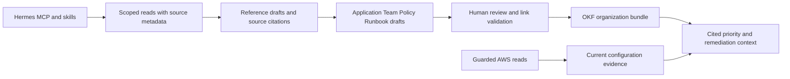

# Knowledge source onboarding and the next release

RemediGenius should reuse Hermes connections and own the conversion of retrieved evidence into reviewed organization
knowledge. The product promise is: connect an existing source, point to relevant material, review what the desk learned,
and see exactly how it changes a finding or a proposed fix. A connector alone does not provide that workflow.

This review is based on local commit `b99ddae`, the published
[v0.7.0 release](https://github.com/IaCGenius/RemediGenius/releases/tag/v0.7.0), and the upstream repositories inspected
on 2026-11-01. Proposed next-release work below is not a claim that these connections have passed the deployment gate.

## Current foundation

The release already collects AWS-native findings, preserves raw evidence and Iceberg facts, and separates model
judgment from deterministic prioritization. The OKF bundle has document imports, references, optional model drafting,
human review, graph navigation and cited priority effects. These are reusable foundations.

The gaps are source connection onboarding, durable source identities and revisions, repeatable refresh, and review
invalidation when upstream material changes. `knowledge.import_reference` currently records a file name and optional
file hash. Its same-hash deduplication is useful for uploaded files, but is not a source synchronization protocol.
Search is lexical. The knowledge skill can draft from configured read tools, but no connector scheduler or complete
source inventory is implemented by this change.

## Reuse matrix

The following catalog entries exist in the
[Hermes v0.21.7 catalog](https://github.com/NousResearch/hermes-agent/tree/v0.21.7/optional-mcps), the source version
recorded for the pinned RemediGenius image. Catalog presence is not a successful authenticated read on that image.

| Source | Existing integration to reuse | Intended knowledge | Qualification |
| --- | --- | --- | --- |
| Confluence and Jira | Hermes `atlassian` catalog entry | Policies, runbooks, ownership and issue context | OAuth and tenant permission required; explicitly select read tools |
| AWS documentation | Hermes `aws-knowledge` catalog entry | Current service behavior, API references and remediation guidance | Public documentation; no proof of account state |
| Notion | Hermes `notion` catalog entry | Architecture, teams and policies | Limit pages to the requested scope |
| Dropbox | Hermes `dropbox` catalog entry | Existing document collections | Validate content retrieval and document conversion |
| GitLab | Hermes `gitlab` catalog entry | Repository documentation and runbooks | Pin source revision and restrict repository scope |
| Linear | Hermes `linear` catalog entry | Ownership, remediation work and decisions | An issue's closure does not prove AWS remediation |
| Google Drive | Official remote Drive MCP through Hermes generic MCP configuration | Documents, policies and architecture | Developer preview; requires eligible account/project and OAuth setup; not a verified catalog one-click path |
| S3 through an existing knowledge base | AWS Labs Bedrock Knowledge Base Retrieval MCP | Cited passages from indexed organization documents | Requires a configured knowledge base and separately scoped AWS credentials; retrieval is not exhaustive bucket ingestion |
| GitHub, SharePoint, OneDrive, Slack | Qualify an existing vendor/community MCP or an existing enterprise retrieval service | ADRs, runbooks, approved decisions | Candidate sources, not certified by this review; prefer durable documents over entire chat histories |

Sources: [Hermes MCP configuration](https://hermes-agent.nousresearch.com/docs/user-guide/features/mcp/),
[Google Drive setup](https://developers.google.com/workspace/drive/api/guides/configure-mcp-server),
[Bedrock retrieval MCP](https://awslabs.github.io/mcp/servers/bedrock-kb-retrieval-mcp-server).

Do not confuse S3 Tables MCP with a document connector: it serves table operations. For plain S3 documents, qualify
an existing object-reading connector with a prefix-scoped role, or use an already operated knowledge base. Do not
require every CE user to provision Bedrock just to import a document. File export and the current Import page remain
the fallback. Reuse the current markitdown conversion rather than add a second Office/PDF conversion stack.

## Operator onboarding method

1. In the actual deployed Hermes profile, inspect `hermes mcp catalog` and install the selected existing entry using
   Hermes's own setup. Use its OAuth login and credential storage. Do not put secrets in OKF or `triage.yaml`.
2. Select an explicit set of read tools through `hermes mcp configure <name>`. Verify the resulting `tools.include`
   against the server's real tool names. Do not use an unrestricted server or assume a skill's instructions enforce
   read-only access. The current RemediGenius toolsets and hooks need deployment testing with each enabled MCP.
3. Read one operator-selected document. Verify the returned object id, canonical URI, actual content and revision
   when available. A successful OAuth exchange or `tools/list` is not a passing connection test.
4. Ask the knowledge skill to digest that bounded source into Reference drafts and supported organization concepts.
   Review references first, resolve their final paths, then review dependent concepts. Confirm bundle validation and
   the predicted priority effect before accepting business-criticality or exception changes.
5. Until refresh tracking ships, treat these as manually captured knowledge. Record a review date; re-read the source
   before using it for a consequential decision. A lost connection must not be described as a deleted document.

The agent never receives the desk's AWS role. A future S3 or Bedrock connector must run outside the agent credential
boundary, using a separately scoped identity. Its data flow, OAuth tokens, backup inclusion and revocation behavior
need to be documented before deployment. Imported excerpts may reach the configured model provider and remain in
local/durable knowledge after access to the upstream source is revoked; live source ACLs alone do not remove copies.

## Shared digestion workflow

Keep facts at the right level. An application has ownership and criticality; an account has environment and scope;
a policy states a requirement; a runbook describes a procedure. Imported text is a Reference, not automatically an
approved policy. A source describing accepted risk does not authorize the agent to suppress findings.

The common source record should contain connection id, provider object id, canonical URI, scope, provider revision,
retrieval time, content hash computed by the capture layer, completeness and parser version. Concept derivations
should point to that exact source revision and relevant excerpts. This is a proposed shared contract, not a reason
to write provider-specific clients. MCP retrieval tools do not all expose version enumeration or change feeds;
advertise only the guarantees the configured provider actually supports.

On refresh, identical content should be a no-op. Changed content should create a reviewable revision and identify
dependent concepts. Preserve the prior human decision and its history; never transfer its approval to new content.
Distinguish access denied, source deleted, connection expired, partial result and transport failure. Define whether
affected approved knowledge continues with a stale warning or ceases to influence scoring; today's stale concepts
still apply, so any stricter policy is an explicit behavior change with tests.

## AWS coverage and Prowler

[Prowler](https://github.com/prowler-cloud/prowler) has a broad detector and compliance catalog, remediation guidance,
ThreatScore, Lighthouse/MCP and AWS attack paths. An AI assistant or graph alone is not a distinctive proposition.
RemediGenius can distinguish itself through organization-aware decisions and an evidenced path from finding to
IaC proposal, deployment observation and target-bound verification. The full live lifecycle still needs proof;
v0.7.0 validation explicitly does not establish a complete campaign lifecycle.

Prefer Prowler's existing Security Hub integration before building a direct scanner runtime. AWS documents
[Prowler as a Security Hub integration](https://aws.amazon.com/blogs/security/enable-security-hub-partner-integrations-across-your-organization/).
The current collector accepts third-party ASFF findings and preserves recommendation text/URL and generator id.
That makes this a promising intake path, not yet a certified Prowler integration. Test representative real ASFF
fixtures for identity, resources, timestamps, remediation URLs and lifecycle; check duplicates against native
Security Hub controls without merging distinct evidence merely because titles look alike.

The existing playbook selector has ten control/title routing rules plus threat and vulnerability routes and a
generic fallback. It does not demonstrate exhaustive AWS remediation coverage. Build a measurable coverage matrix
for each supported control family: explanation, decisive read, prerequisites, fix guidance, IaC pattern, blast radius,
rollback, verification and escalation. Retain Prowler check ids separately from AWS control ids. Refer to upstream
guidance with revision and attribution; validate licensing before copying content into the shipped bundle.

Prioritize IAM/trust, public network exposure, S3 protection, detection gaps, and image/package vulnerabilities.
Use AWS Knowledge MCP for current documentation and the guarded desk for account evidence. Evaluate both a correct
answer and an honest refusal when evidence, scope or permissions are incomplete.

## Proposed next release acceptance criteria

| Deliverable | Required proof |
| --- | --- |
| Reused connector onboarding | Actual read on pinned Hermes; correct profile; read-only tool selection; OAuth restart/refresh behavior |
| Shared source capture | Stable identity, provenance, deterministic deduplication, bounded input and partial-read reporting |
| Organized OKF digestion | Supported facts only, valid links, no inherited approval, conflicts visible, imported text cannot authorize tools |
| Source refresh | Unchanged no-op; changed source requires review; deletion and denial distinct; affected concepts identified |
| AWS guidance quality | Coverage matrix and representative evidence/fix/rollback/verification evaluations; generic fallback measured |
| Prowler intake | Realistic ASFF fixtures plus live sample through Security Hub; no invented control mapping or false closure |
| Deployment | Local suite, container wiring, fresh disposable Spot gate, source read and review flow, restart restore and teardown |

Group certification by connection, not a blanket claim of support for every MCP. A concrete first release gate should
exercise AWS Knowledge and one authenticated document provider plus the shared capture tests. Other providers can use
the same path while remaining labelled configured-but-unvalidated until their authentication and read paths pass.

The working changes now include source URI/revision capture, a Sources screen linking to native Hermes connection
management, and correct Team/source links in generated concepts. Existing MCP catalog entries were configured on
the disposable lab, not installed automatically for every user. No source synchronization scheduler or release
version change is included. Provider sign-in and selected source material remain necessary for authenticated reads.

## Validation of this change

On 2026-11-01, the Windows offline suite passed with **747 passed, 7 skipped** (273.87 seconds). The first sandboxed
attempts encountered Windows temporary-directory permission errors; the completed run used the normal host context
and the suite's offline AWS fixture. Skill safety lint reported no findings, protected instruction blocks were
preserved, and `git diff --check` passed. That earlier run proved local regressions only.

The subsequent live-first evaluation deployed the unchanged published v0.7.0 to a new disposable Spot stack,
then applied locally recorded patches with file hashes and baseline backups. See
[the live evaluation record](KNOWLEDGE-LIVE-EVALUATION.md) for the actual results and remaining limits.
No release was built or published.
