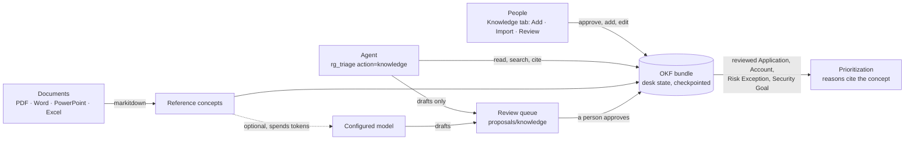

# Knowledge — RemediGenius Community Edition

The security desk's knowledge is one [Open Knowledge Format](https://github.com/GoogleCloudPlatform/open-knowledge-format)
(OKF v0.2) bundle per installation: a folder of markdown concepts with YAML frontmatter, generated `index.md` files, a
`log.md` history, and markdown links that form a graph. People review it, the agent reads and cites it, and reviewed
concepts change the desk's priorities with a citation in every finding they touch.



## What is in the bundle

| Folder | Who writes it | What it is |
| --- | --- | --- |
| `remedigenius/guides/` | shipped | How the desk works, where to look for evidence, how organization knowledge changes triage |
| `remedigenius/sources/` | shipped | One guide per finding source: what it tells you, how it is scored, blind spots, what to check next |
| `remedigenius/playbooks/` | shipped | The remediation playbooks `rgtriage fix` uses (S3 public access, security groups, root, IAM, threats, CVEs …) |
| `applications/`, `accounts/`, `teams/` | you | What runs where, how critical it is, who owns it |
| `exceptions/`, `goals/` | you | Accepted risks with an expiry; what matters most this quarter |
| `policies/`, `runbooks/`, `architecture/`, `notes/` | you | Rules, procedures and context the agent respects in answers and fix proposals |
| `references/` | document import | Converted documents that other concepts cite |

`remedigenius/` is refreshed on every start of the desk, so it follows the installed release. Never edit it; add your
own Policy, Runbook or Note that links to it instead.

## How knowledge changes priorities

Only **human-reviewed, stable** concepts change scores (OKF trust tier `human-reviewed`: a `verified` entry by a
`human:` actor). Drafts, unreviewed and deprecated concepts are context only. Each effect appears in the finding's
"why this priority" reasons with the concept path, and `rgtriage show REF` lists every concept used.

| Type | Settings (`remedigenius:` in the frontmatter) | Effect |
| --- | --- | --- |
| Application | `match_tags`, `criticality`, `owner`, `data` | Resources with all the tags get the criticality (mission critical +15 … test −10); findings show the owner |
| Account | `account_id`, `criticality`, `environment`, `owner` | Every finding in the account gets the criticality, unless an application match is more specific |
| Risk Exception | `control_id` / `finding_type` / `resource`, optional `account_id`, `expires`, `approved_by` | Matching findings count as accepted risk until the expiry date; then they return with "exception expired" |
| Security Goal | `resource_types`, `categories`, `signals`, `points` (1–15) | Matching findings get the points, cited with the goal |
| Team | `contact`, `escalation` | Named as owner through applications and accounts |

A decision you record on a finding always wins over a risk exception. `triage.yaml` business context still works
and applies after the knowledge concepts.

## The Knowledge tab

Open the dashboard (workstation `http://127.0.0.1:9125`, Spot through the SSM tunnel) and choose **Knowledge**.

- **Overview:** concepts, how many are reviewed, how many currently change priorities, drafts waiting, stale concepts,
  and *what the desk is missing*, for example "7 open P1/P2 findings sit on resources the desk cannot map to an
  application", each with a button to add the right concept. It also runs the bundle check (OKF conformance and broken links).
- **Browse:** search and filter concepts; each concept shows its effect, settings, sources, rendered text, links and
  backlinks. Mark reviewed, edit the OKF source, deprecate, or move to the trash (kept, never deleted).
- **Review:** drafts from the agent and from document import. Preview the effect, edit if needed, choose the path,
  then approve (you become the reviewer) or reject (kept in `.rejected`).
- **Add:** a guided form per type with a plain-language preview ("Resources tagged app=payments will be scored as
  mission critical (+15), with owner Payments team"). Concepts you add are recorded as reviewed by you.
- **Import:** PDF, Word, PowerPoint, Excel, Markdown, text or CSV becomes a Reference concept. A Markdown file that is
  already an OKF concept, or a `.zip` of a bundle (for example exported from another OKF tool), goes to the review queue.
- **Graph:** every concept and link; colour by type, solid ring when reviewed, dashed when not, orange when stale.

The reviewer name at the top is recorded as `human:<name>` (default: the dashboard login name).

### Documents and the model (token use)

- **Conversion is local and free.** PDF and Office files are converted by [markitdown](https://github.com/microsoft/markitdown)
  (MIT), installed on first use from the Import page into `installs/rg-documents` in the Hermes home (about 350 MB,
  not part of the checkpoints). It runs without the model key, without the dashboard's secrets and without AWS
  credentials. Markdown, text and CSV need no converter.
- **Drafting with AI is optional and spends tokens.** After an import, or for any reference, *Draft with AI* shows
  the estimate first (about one token per four characters, up to the first 60,000 characters, plus up to 6,000 output
  tokens) and the model it will use. Nothing is sent until you confirm. The call uses Hermes's own plugin model access
  with your configured provider; the result shows the tokens actually used. The model proposes up to 12 concepts;
  they land in the review queue as drafts with the document as their source.

## What the agent does with it

The `rg-knowledge` skill and the read-only `rg_triage action=knowledge` tool:

- `view=overview` (index, what changes priorities, gaps), `search`, `show` a concept, `for` a finding ref (what was
  applied, the playbook and source guide, matching organization concepts), `gaps`, `review`, `validate`.
- It cites concepts with their trust tier, says when one is stale, and respects Policy and Runbook concepts in fixes
  (`rgtriage fix` lists the relevant ones).
- When it learns something from you ("payments-db belongs to the payments team; an outage stops card payments"), it
  writes a draft to `proposals/knowledge/…` and tells you to review it. It cannot write to the bundle or mark anything
  reviewed: its file writes are limited to the proposals folder, and the tool has no edit action.

## Command line

```sh
rgtriage knowledge                       # overview, gaps and the index
rgtriage knowledge search payments owner
rgtriage knowledge show applications/payments.md
rgtriage knowledge for 3f9c2a7b1d04      # concepts relevant to a finding
rgtriage knowledge validate              # OKF conformance and broken links
rgtriage knowledge-edit save --fields f.json --kind Account --by human:alex --verify   # what the Add form does
rgtriage knowledge-edit verify --path applications/payments.md --by human:alex
```

`knowledge-edit` reads files only from the knowledge inbox and review folders (`proposals/knowledge`,
`knowledge-inbox`), never from arbitrary paths, and refuses symbolic links.

## Where it lives and how it is kept

| | Bundle | Review queue | Imported originals |
| --- | --- | --- | --- |
| Spot | `/data/rgtriage/knowledge` (desk state, S3 checkpoints) | `/data/hermes/proposals/knowledge` | `/data/hermes/knowledge-files` |
| Docker workstation | desk volume `knowledge/` (checkpointed to `~/RemediGenius-CE/durable`) | Hermes volume `proposals/knowledge` | Hermes volume `knowledge-files` |
| Existing Hermes | `~/.rgtriage/knowledge` | `~/.rgtriage/proposals/knowledge` | `~/.rgtriage/knowledge-files` |

The bundle is plain files: you can also put it in git, open it in Obsidian or VS Code, or check it with OKF tools such as
[okfctl](https://github.com/cwest/okfctl) (`okfctl validate`). Edits made outside the tab apply at the next scan; run
`rgtriage knowledge-edit reindex` to refresh the `index.md` files.

## Limits

- Search is lexical (titles, tags, descriptions, settings, text); there is no embedding index.
- A concept is at most 400 KB; imports up to 15 MB; long references are truncated with a note.
- Application matching uses exact tag values. Risk exceptions match an exact control id, a finding type substring or an
  exact resource id/name.
- Knowledge text is data. The agent treats it as information, never as instructions, but what you import reaches your
  model provider when the agent reads it or when you draft with AI.
