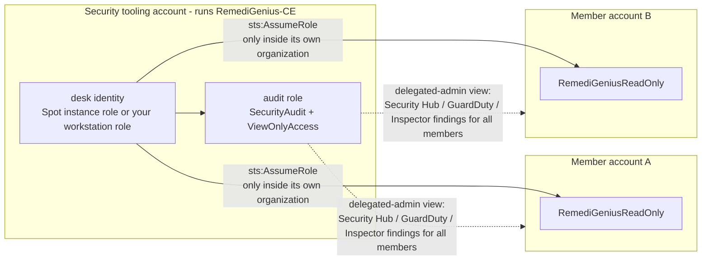

# Multiple AWS accounts — RemediGenius Community Edition

**Short version:** run RemediGenius-CE in one account of your AWS Organization, ideally your security tooling
(delegated administrator) account, and deploy one read-only role to the other accounts with a StackSet. That StackSet
is the only manual step. Everything else is automatic: the desk finds the accounts, works out what it can read, reads
them from the next scan on, and tells you on the board what is still missing.

## What happens automatically

Before every scan (every 6 hours on Spot by default, and whenever you or the agent ask), the desk:

1. **Finds your organization.** It reads the organization id. Any member account may do this; there is nothing to
   configure.
2. **Detects delegated administrator rights.** It checks whether its own account is the Security Hub, GuardDuty or
   Inspector delegated administrator, and which member accounts each one covers. You do not set this anywhere. When it
   is the Inspector administrator, Inspector totals cover the whole organization.
3. **Lists candidate accounts.** These are all organization accounts if the identity may list them (management account
   or Organizations delegated administrator); otherwise the member accounts named by the administrator views, plus any
   in `triage.yaml`.
4. **Tries the read role in each account.** It attempts `sts:AssumeRole` on `RemediGeniusReadOnly`. If the role works,
   the account is read fully from this scan on. Its existing findings become the baseline, so a new account never sets
   off a flood of alerts. If it doesn't, the account is reported as *findings only* (visible through the administrator
   view) or *not covered*.
5. **Avoids double reads.** Services the administrator view already covers (for example GuardDuty for a member) are not
   read again in the member account.

**You find out from the board and from alerts:**

- The attention board (the agent opens every new chat with it) shows a line like
  `Accounts: 4 read fully · 7 findings only (delegated-admin view, no RemediGeniusReadOnly role) · 1 not covered · delegated administrator for: securityhub, guardduty, inspector`.
- When a role starts working, the board says *Newly onboarded this scan: …*. The `security-watch` alert says it too.
- Ask the agent *"which accounts are covered?"* or *"help me onboard the other accounts"*, or run `rgtriage onboarding`.
  It prints the coverage and the exact StackSet command, already filled in with your desk identity's ARN and organization id.



## The one manual step: deploy the read role

Run `rgtriage onboarding` (or ask the agent) and copy the command it prints. It looks like this:

```sh
# with management-account (or StackSets delegated administrator) credentials, from the release folder
aws cloudformation create-stack-set --stack-set-name remedigenius-ce-read \
  --template-body file://deploy/aws-single/member-read-role.yaml \
  --permission-model SERVICE_MANAGED --auto-deployment Enabled=true,RetainStacksOnAccountRemoval=false \
  --capabilities CAPABILITY_NAMED_IAM \
  --parameters ParameterKey=TrustedPrincipalArn,ParameterValue=<printed by rgtriage onboarding> \
               ParameterKey=OrganizationId,ParameterValue=<printed by rgtriage onboarding>
aws cloudformation create-stack-instances --stack-set-name remedigenius-ce-read \
  --deployment-targets OrganizationalUnitIds=<root-or-ou-id> --regions <one-region>
```

- **Run it after the RemediGenius-CE stack exists.** IAM rejects a trust policy that names a role that doesn't exist yet.
- **`TrustedPrincipalArn` is the desk identity.** On Spot that's the instance role (Terraform output `instance_role`). On
  a workstation it's your IAM role or user; IAM Identity Center roles include their `/aws-reserved/…` path, which
  `rgtriage onboarding` resolves for you.
- **Auto-deployment covers new accounts.** Accounts added to the organization later get the role automatically, and the
  next scan picks them up.
- **StackSets skip the management account.** Deploy the template there as a normal stack if you want it read.
- **No restart, redeploy or Terraform change is needed** once the roles exist.

**What the role allows:** `SecurityAudit` + `ViewOnlyAccess`, with an explicit deny on secret, parameter, object, KMS and
table-content reads. Its trust policy allows only the desk identity, and only from inside your organization. The Spot
instance role may assume `RemediGeniusReadOnly` only in accounts of its own organization (`aws:ResourceOrgID` must
equal `${aws:PrincipalOrgID}`). It never needs an organization id from you, and it can assume nothing if the account is
not in an organization.

## Where to run it

| You run the desk in | Without member roles | With member roles |
| --- | --- | --- |
| Security Hub / GuardDuty / Inspector delegated administrator | org-wide findings for those three services | plus investigations, Config, Access Analyzer, CloudWatch alarms in every account |
| Any other member account | its own account only | every account with the role, read one by one |

The delegated administrator account is recommended: you get the org-wide findings view on day one, before any role is deployed.

**Only member roles give these per account:** investigations (CloudTrail, IAM, resource configuration), AWS Config
rules and conformance packs, IAM Access Analyzer account analyzers, CloudWatch alarms and Health. Findings seen through
both paths are de-duplicated by their native finding id.

## Settings (optional)

In `triage.yaml`:

```yaml
organization:
  discover: true                      # false: read only the accounts listed under `accounts:`
  member_role_name: RemediGeniusReadOnly
  criticality: business_critical      # default for discovered accounts
accounts:
  - name: payments-prod               # list an account to override its name, criticality, regions or owner
    account_id: "111122223333"
    role_arn: arn:aws:iam::111122223333:role/RemediGeniusReadOnly
    criticality: mission_critical
```

Spot Terraform variables:

| Variable | Default | When you need it |
| --- | --- | --- |
| `member_role_name` | `RemediGeniusReadOnly` | you deployed the role under another name |
| `member_account_ids` | `[]` | the desk can neither list the organization nor see an account as delegated administrator |
| `member_role_arns` | `[]` | accounts outside an AWS Organization (explicit role ARNs) |

**No organization?** Deploy `member-read-role.yaml` in each account as a normal stack with `OrganizationId` left empty.
Then list each account under `accounts:` with its `role_arn`, and on Spot add the ARN to `member_role_arns`.

## Workstation

The same flow works from the Docker workstation. The desk identity is your AWS profile's identity (or `--read-role-arn`),
and `rgtriage onboarding` prints that ARN for the StackSet command. The role trusts one desk identity: to move from a
workstation trial to Spot, update the stack set's `TrustedPrincipalArn` parameter (`aws cloudformation update-stack-set
--use-previous-template ...`) to the instance role instead of creating a second one.
