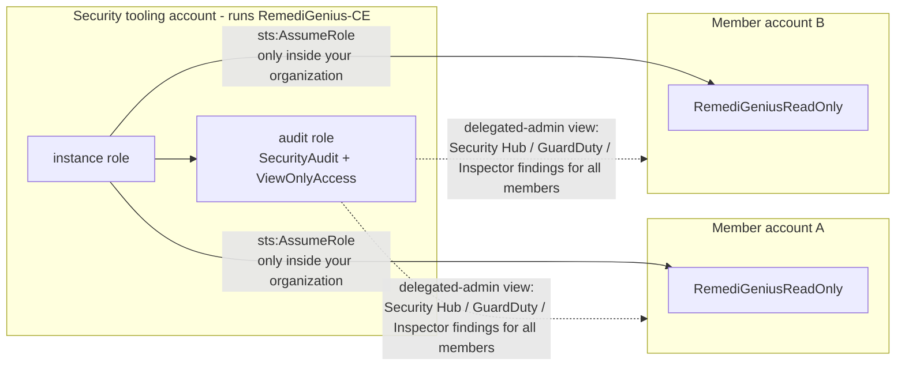

# Multiple AWS accounts — RemediGenius Community Edition

The desk reads every account through a **read-only role in that account**. The instance role (Spot) or your workstation
identity only *assumes* those roles; it never reads security data with its own permissions. There are two complementary
models. Most organizations use both.



## Model 1 — delegated administrator (fewest roles)

Deploy RemediGenius-CE in the account you made **delegated administrator** for Security Hub, GuardDuty and Inspector
(often called the security tooling or audit account). Its audit role then sees findings for every member account,
including Security Hub's cross-region aggregation. Set `delegated_admin = true` so Inspector totals and fix units cover
the whole organization instead of only the admin account.

Covers: Security Hub, GuardDuty and Inspector findings for all members.
Does not cover: reads *inside* member accounts. Investigations (CloudTrail, IAM, resource configuration), AWS Config
rules and conformance packs, IAM Access Analyzer account analyzers, CloudWatch alarms and Health all live in each account.

## Model 2 — one read-only role per account (full coverage)

Deploy [`member-read-role.yaml`](../deploy/aws-single/member-read-role.yaml) to every member account as a
**service-managed CloudFormation StackSet**. Run this from the management account, or from a delegated StackSets
administrator, after the RemediGenius-CE stack exists (IAM needs the trusted instance role to exist):

```sh
aws cloudformation create-stack-set --stack-set-name remedigenius-ce-read \
  --template-body file://deploy/aws-single/member-read-role.yaml \
  --permission-model SERVICE_MANAGED --auto-deployment Enabled=true,RetainStacksOnAccountRemoval=false \
  --capabilities CAPABILITY_NAMED_IAM \
  --parameters ParameterKey=InstanceRoleArn,ParameterValue=<terraform output instance_role> \
               ParameterKey=OrganizationId,ParameterValue=<o-xxxxxxxxxx>
aws cloudformation create-stack-instances --stack-set-name remedigenius-ce-read \
  --deployment-targets OrganizationalUnitIds=<ou-or-root-id> --regions us-east-1
```

Every member account gets the same role, `RemediGeniusReadOnly`: `SecurityAudit` + `ViewOnlyAccess` with an explicit
deny on credential and data reads. Its trust policy allows only the RemediGenius-CE instance role, and only from
inside your organization. With auto-deployment, new accounts get the role automatically.

Then, in the RemediGenius-CE stack:

```hcl
organization_id    = "o-xxxxxxxxxx"            # lets the instance role assume RemediGeniusReadOnly in any org account
member_account_ids = ["111111111111", "222222222222"]
# member_role_name = "RemediGeniusReadOnly"    # default
```

The instance role gets one statement, `sts:AssumeRole` on `arn:aws:iam::*:role/RemediGeniusReadOnly`, conditioned
on `aws:ResourceOrgID`, so it can never assume a role of that name outside your organization. At boot, accounts listed
in `member_account_ids` are added to the desk's `triage.yaml`. `delegated_admin = true` is added to this account's entry
if it has no such setting yet. Existing values and your edits (criticality, owner) are never overwritten. List all accounts with `rgtriage discover-accounts` (needs organization read permission).

No organization? Deploy the template per account and pass the role ARNs as `member_role_arns` instead of `organization_id`.

## Which reads go where

| Need | Model 1 (delegated admin) | Model 2 (member roles) |
| --- | --- | --- |
| Security Hub / GuardDuty / Inspector findings across accounts | yes | yes (per account) |
| Investigate inside a member account (CloudTrail, IAM, EC2, S3 config) | no | yes |
| Config rules, Access Analyzer, CloudWatch alarms per account | no | yes |
| Extra IAM to manage | none | one StackSet |

Findings seen through both models are de-duplicated by their native finding id.

## Workstation

The same roles work from the Docker workstation: add the member accounts to `triage.yaml` with their `role_arn`. The
identity that assumes them (your profile or `--read-role-arn`) must be trusted by the member roles. Deploy the
template with that identity's role ARN as `InstanceRoleArn`.
