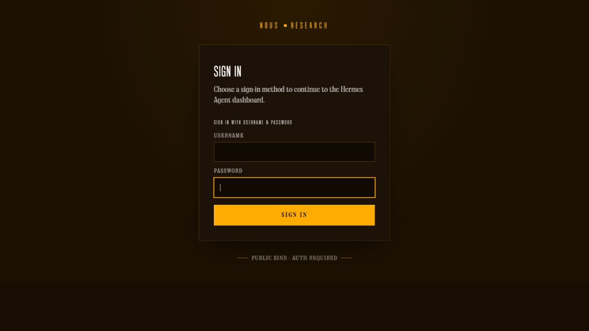
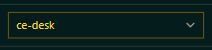
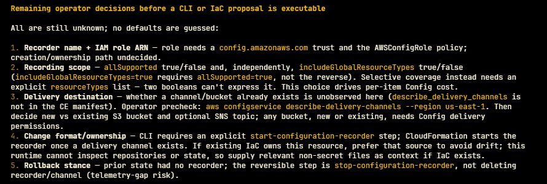

# Your first CE investigation

This preview is qualified with **AWS us-east-1 and Qwen 3.8 Max**. You supply your
own AWS access and model credentials. CE uses native Hermes as its agent and UI;
the scoped reader collects AWS facts, and S3 retains their receipts. Start with
[the architecture](diagrams/ce-mvp-architecture.html).

## 1. Choose where Hermes runs

| Choice | Follow | What persists |
|---|---|---|
| Your workstation, Docker | [Workstation setup](WORKSTATION-HERMES.md) | Named Docker volume for conversations/cases; AWS S3 for collected evidence |
| Your AWS account, Spot EC2 | [AWS setup](NATIVE-CE-QUICKSTART.md) | Retained EBS for conversations/cases; S3 for evidence and selected knowledge |

Both paths use the AWS read executor and your configured scope. Local Docker is
not an offline AWS simulator. Review the supplied Terraform before applying it.
The guides distinguish operator credentials, the bounded reader identity, model
credentials, and the dashboard login. Never paste any of these secrets into chat.

## 2. Sign in and select ce-desk

Follow your deployment guide's login command. For AWS, keep the SSM tunnel open;
`tools/open-native-hermes.ps1 -WithLogin` displays the existing dashboard login
and starts the tunnel. Run it only in your private terminal. The dashboard password
is not a model API key. For Docker, use the launcher's `login` command.

Open `/chat?profile=ce-desk` on your local dashboard address and confirm the
profile selector. These are cropped screenshots of the real dashboard; they
exclude credentials, session identifiers and account details.

The upstream default route is guarded with the same CE boundary and provider.
Use ce-desk for your work; a default label on another native page is not a second
unrestricted CE agent.

## 3. Discover coverage before interpreting findings

Ask:

> What AWS sources can you read for my configured target in us-east-1? Distinguish
> source availability from collected findings. Show scope, observation times,
> receipts and missing information.

Then choose a concrete investigation, for example:

> Collect current Security Hub findings within the configured page budget. Explain
> the most important observed issues, what remains uncollected, and which claims
> are facts versus your interpretation. Do not change AWS.

An unavailable service, access denial or empty result is useful coverage information,
not a clean security assessment. See [the capability matrix](AWS-MVP-CAPABILITIES.md)
for supported reads versus demonstrated live results. A configured service may
have no findings in this account. CE does not enable services for you.

## 4. Bring one piece of organizational context

Ask Hermes to help draft a short policy or application note. Review it, save it as
Markdown, and follow [the knowledge walkthrough](NATIVE-KNOWLEDGE-QUICKSTART.md)
to import it, select a view, and activate that view for your deployment. Supported
document conversion uses MarkItDown. Chat text or an uploaded attachment alone
does not publish shared knowledge in this preview.

Ask:

> Use the selected knowledge for this assessment. Show Source, Applies because,
> Effect and Unknowns. If scope or purpose is unclear, ask me rather than assume.

Knowledge changes the interpretation and priority; it does not rewrite AWS facts.
Conflicting policies remain a question for the operator. Edit originals and import
a replacement; direct edits to generated views are discouraged and fail hash checks.

## 5. Prepare a fix and keep it for later

Ask for an AWS CLI proposal, or request Terraform/CloudFormation using your
existing source. Require prerequisites, impact, validation actually performed,
rollback and fresh verification reads. A model critique is not a provider schema
validation. You execute changes through your normal change process.

This real Config follow-up shows the decisions needed before producing an
executable proposal; no account identifiers or case history are included in the crop.

Ask **“Track this finding on the board with the proposal and remaining decisions.”**
Use native Kanban's `ce-cases` tenant, or ask **“List my cases”** and **“Resume case
ID.”** Board cards do not launch autonomous workers. When a change is complete,
ask Hermes to collect fresh evidence and reassess before proposing closure.
See [the operating loop](OPERATING-LOOP.md) for closure reasons and limitations.

## 6. Return to fresh evidence

Enable the deterministic schedule explicitly in your deployment configuration
and start with 24 hours. Ask **“Show the latest scheduled checks, freshness and
what changed.”** The schedule does not call an LLM and runs independently of the
Spot instance. More frequent checks cost additional AWS requests/storage.
Stopping Hermes does not stop that schedule; disable it separately when needed.

Keep deployment inputs and secrets private. Back up your conversation/case volume;
S3 evidence alone does not restore the Kanban database. The setup guides explain
stop/restart and credential renewal. This is a single-operator preview with bounded
collection, not continuous monitoring of every AWS resource or automatic remediation.
