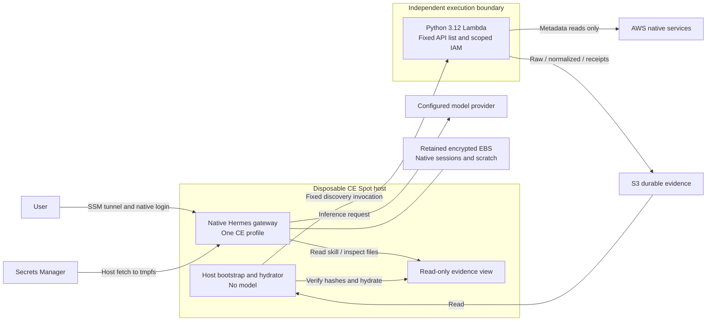

# Native Hermes CE: first AWS sketch

This sketch follows the Hermes-first direction. It is separate from the earlier
custom CE console and the parked v2 deployment. The user speaks to native Hermes,
selecting the single `ce-desk` profile. It provides readable instructions and
skills; upstream Hermes supplies the agent loop, model integration and interface.

## Boundaries and control flow

The model has no AWS credentials. Host IAM can invoke one discovery function and
read this sketch's S3 prefix. Lambda has the service-read permissions and writes
the evidence. The Docker mount makes that evidence read-only to Hermes. The CE profile handles both summaries and detailed investigations.
The builder is not enabled.

## What counts as truth

| Layer | Producer | Meaning |
|---|---|---|
| `raw/<run>/` | Fixed AWS API collector | Original response, request scope, time and API errors |
| `normalized/<run>/` | Deterministic Python | Availability classification with raw-file references |
| `receipts/<run>.json` | Collector | Input/output hashes, collector hash and SDK version |
| `catalog.json` | Collector | Current run pointer, coverage and limitations |
| Organization knowledge | Not populated in this sketch | Must not be invented by the model |
| Hermes responses and scratch | Model | AI interpretation; not a replacement for the records |

The collector uses create-only requests for run files. This is application-level
write discipline, not S3 Object Lock or cryptographic source authentication.
Hydration verifies hashes before publishing the local catalogue. A newer catalogue
does not delete older run records. The model may summarize and explain but must
preserve deterministic classifications and cite paths and observation times.

Collection runs once on host bootstrap. A 30-second host timer refreshes the local
view from S3; it does **not** recollect AWS or call a model. Agent-triggered collection
is not yet wired into this sketch. A later skill can request a fixed authorized
job through the execution boundary without granting general AWS CLI access.

## Targeted AWS scope

The first collector reads availability metadata for Security Lake, Security Hub,
GuardDuty, Inspector, AWS Config and CloudTrail in one account and one region.
It does not enable services, read event bodies, run Athena queries, or claim
an assessment has taken place. `access_denied` and `unknown` are explicit outcomes.
CloudTrail trail discovery alone does not establish current logging or event access.

The optional fixed `collect_securityhub` job adds one page of at most 20 ACTIVE
findings, filtered to this account and ordered by update time. It records original
responses and deterministically extracts identifiers, resources, severities and
sample counts. `has_more` marks truncation; these are sample counts, never an
account-wide risk total. The model does not assign those severities or counts.

Security Lake already provides normalized OCSF data. When available and authorized,
reuse its S3 subscriber or Lake Formation/Athena query access. Preserve the existing
normalization; add receipts and bounded deterministic extraction. For a first real
investigation, select one source, a short time range and a small set of fields,
with an enforced query/bytes budget. Do not create a new lake just for this demo.
See [AWS Security Lake overview](https://docs.aws.amazon.com/security-lake/latest/userguide/what-is-security-lake.html)
and [subscriber query access](https://docs.aws.amazon.com/security-lake/latest/userguide/subscriber-query-access.html).

## What survives compute loss

S3 holds authoritative collected data independently of Lambda and Spot lifetime.
The local evidence view can be reconstructed from S3. Native Hermes sessions and
scratch currently survive on a separate retained encrypted EBS volume, in the same
availability zone. They are **not yet exported to S3**, and this sketch has no
session snapshot schedule. Do not claim that all state is object-storage-backed.
Replacement must wait for the old instance to release the volume; no force detach.

The ASG maintains one Spot host. Pausing means setting its desired capacity to zero
through the deployment configuration, not simply stopping its instance. Storage
and secret resources remain. An interrupted in-flight model response may need to
be retried; evidence already in S3 remains available.

## Review experience

Use the native gateway through a private SSM tunnel, then select `ce-desk`. Ask:

> Read the current shared-evidence catalogue. Which native AWS sources appear
> available, what was actually collected, and what remains unknown? Cite receipts.

Then ask the same agent for a deeper explanation of one source. Skills and profiles
are plain files in `profiles/native-sketch`. Other native channels are an upstream
option, but no messaging channel or external recipient is configured by this stack.
No MCP server is required for this experience.

Deployment source: [native sketch](../deploy/aws-native-sketch/README.md).
Live acceptance results should be recorded separately; a Terraform validation or
an offline test is not evidence of a working cloud/model journey.
