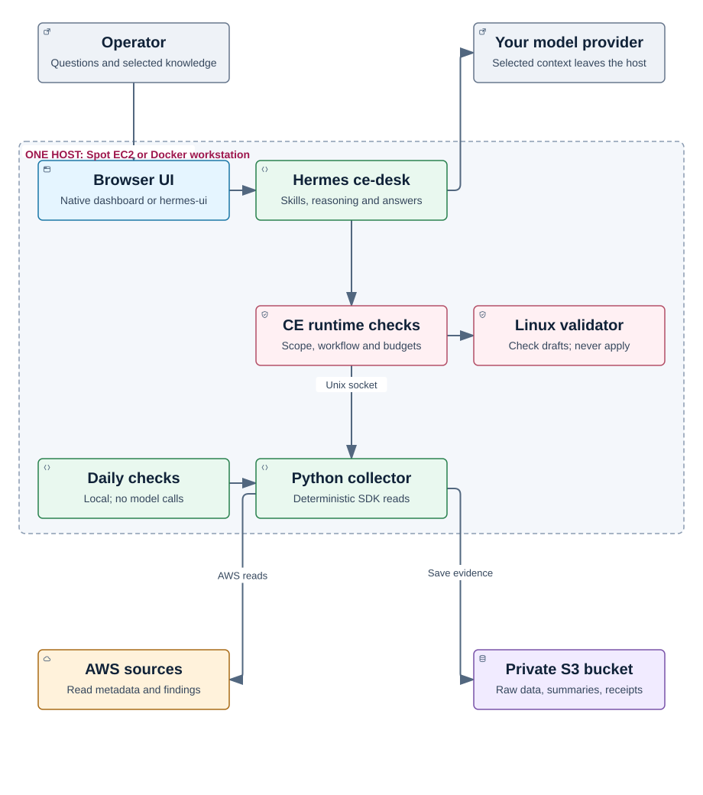
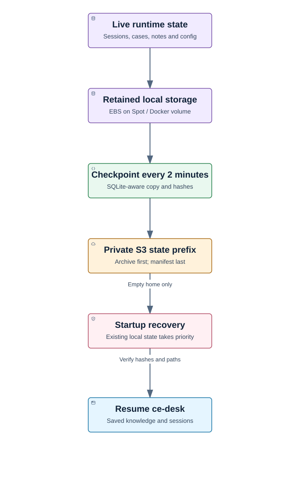

# Single-host deployment migration

This page describes the single-compute architecture. The supported setup uses
AWS us-east-1, one operator and DeepSeek v4.1 Flash as the test model. See the
[validation record](RELEASE-VALIDATION.md) for actual checks. Existing Lambda
installations must use a separate stack/state when migrating.

## What changes

Both deployments use Hermes, the CE skills and execution rules, a local Python
collector (`deploy/collector`) and the Linux remediation validator. The collector
calls AWS through the SDK and writes raw responses, normalized summaries and
receipts to S3. It does not ask the model to write collection code. There is no
Lambda function and no EventBridge schedule.

See [the component map](diagrams/README.md) for source paths and access boundaries.

Skills guide investigation. Code enforces the allowed operations, scope,
pagination bounds and workflow. A model cannot gain more AWS permissions by
changing a prompt. Remediation remains a proposal for the operator to apply.

## AWS resources

The new stack is in `deploy/aws-single/`. It creates a private, versioned S3
bucket, a Spot Auto Scaling group, launch template, security group, encrypted
retained EBS volume, instance role and instance profile. It uses an existing
subnet. It does not create Lambda functions, EventBridge schedules, a new VPC,
or a NAT gateway. Network access to AWS, image registries and the chosen model
endpoint must exist. The dashboard listens on loopback and is reached with SSM.

The instance role combines AWS metadata/security reads with narrow access to
CE's own bucket and retained volume. Those operational writes are necessary;
the role as a whole is not read-only. Hermes receives no AWS credentials and runs
with `AWS_EC2_METADATA_DISABLED=true`. The instance requires IMDSv2
(`http_tokens = "required"`) with a response hop limit of 1, so a process inside
the Hermes container cannot fetch the SDK's temporary credentials. The collector
runs separately and uses temporary instance-role credentials. The operator's own
provisioning credentials are used only for Terraform and SSM, not by the host.

Amazon Linux 2023 is the host. Amazon Linux 2 is no longer a suitable new
baseline. The upstream Hermes image stays pinned. CE's collector uses one pinned
Python 3.12 image and an exact boto3/botocore dependency set. The OS bootstrap
and upstream Hermes have their own vendor-managed interpreters; CE does not
replace them or install a Python environment per skill.

See [AWS's Amazon Linux 2 lifecycle FAQ](https://aws.amazon.com/amazon-linux-2/faqs/)
and [Amazon Linux 2023 Python guidance](https://docs.aws.amazon.com/linux/al2023/ug/python.html).

## Storage and interruption

S3 evidence is written during collection. Sessions and cases use retained EBS
while the instance is running. A two-minute timer makes SQLite-aware checkpoints
to S3. An immutable checkpoint is uploaded first; the latest manifest is updated
last. Restore verifies hashes and paths before Hermes opens the restored files.

This is not zero-data-loss replication. An abrupt loss can lose activity since
the last successful checkpoint. A failed checkpoint can extend that interval.
Check the timer and S3 manifest rather than assuming that the latest chat is
already backed up. Existing EBS takes precedence over restore to an empty home.

Checkpoints include private sessions, configuration, dashboard login and any
model credentials stored in Hermes. Protect access to the whole state prefix.
The model-facing evidence reader cannot read that prefix. Do not share state
archives as diagnostic bundles.

Checkpoint archives are not automatically expired. The bucket is versioned, so
older object versions also use storage. Review storage usage and choose a
retention policy deliberately. Do not delete the checkpoint named by the latest
manifest or your required recovery copies.

## Model and knowledge

An existing model secret can be supplied; the host reads only that secret and
uses `GetSecretValue` for that exact ARN. For a customer-managed encryption
key, grant the specific decrypt permission. Otherwise configure the provider and
key inside Hermes after login. Keep the custom OpenAI-compatible route
(`provider: custom`, `key_env: MODEL_API_KEY`). Never put a key in a chat message
or in tfvars. **Without a working model key, the stack is not ready to
investigate.** A configured model name is not proof of model access.

Existing knowledge remains operator supplied. Its source, scope and hash must
remain visible. Chat intake can stage a Markdown note, show its scope and ask the
operator to send an exact `publish knowledge <id>` phrase. Published notes are
ordinary files with a content hash. They are included in state checkpoints.
File-based knowledge views still use the existing import/export tools. Spot
replacement retained the published note and conversations. A separate empty
Docker volume restored the checkpointed file view with a matching content hash.
These checks do not imply zero data loss between checkpoints.

## Scheduling

Checks run on the collector's compute. S3 holds the last check report. A restart
can run one overdue bounded check; it does not replay every missed interval.
No scheduled collection runs while both local and Spot compute are off. Checks
collect and compare evidence; they do not silently start model investigations.

## Optional browser UI

The optional `hermes-ui` is a second interface to the same gateway and profile.
Chat, profile selection and reopening native conversations are tested. Use the
native dashboard for Kanban and administrative controls. The Bots panel and
skill-category search do not have full parity.

## Acceptance before cutover

- Fresh Spot bootstrap and both UIs work.
- Real AWS reads use the instance role; receipts distinguish partial results.
- Knowledge intake, selection and use work through the supported interface.
- Checkpoint and restore retain sessions, cases, knowledge and model settings.
- Replacement does not overwrite operator customization.
- Docker workstation uses the same collector and passes live functional tests.
- Fix validation remains isolated and applies no changes to AWS.
- Public setup, stop, recovery and removal instructions match the tested path.

Check the validation record before cutover. The previous Lambda implementation is
preserved in earlier immutable tags and the separate v2 source archive. Removing
an old installation is an explicit operator action after backup.
