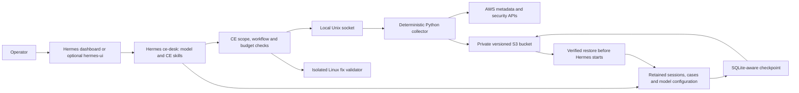

# Single-host deployment migration

Implementation is in progress. This page describes the new deployment; it is
not a release-readiness claim. Keep an existing deployment until the replacement
passes the acceptance checks below.

## What changes

Both deployments use Hermes, the CE skills and execution rules, a local Python
collector, and the Linux remediation validator. The collector calls AWS through
the SDK and writes raw responses, normalized summaries and receipts to S3.
It does not ask the model to write collection code.

Skills guide investigation. Code enforces the allowed operations, scope,
pagination bounds and workflow. A model cannot gain more AWS permissions by
changing a prompt. Remediation remains a proposal for the operator to apply.

## AWS resources

The new stack is in `deploy/aws-single/`. It creates a private, versioned S3
bucket, a Spot Auto Scaling group, launch template, security group, encrypted
retained EBS volume, instance role and instance profile. It uses an existing
subnet. It does not create Lambda functions, EventBridge schedules, a new VPC,
or a NAT gateway. Network access to AWS, image registries and the chosen model
endpoint must exist. The dashboard listens on loopback and is reached with SSM.

The instance role combines AWS metadata/security reads with narrow access to
CE's own bucket and retained volume. Those operational writes are necessary;
the role as a whole is not read-only. Hermes receives no AWS credentials.
The collector runs separately and uses temporary instance-role credentials.

Amazon Linux 2023 is the host. Amazon Linux 2 is no longer a suitable new
baseline. The upstream Hermes image stays pinned. CE's collector uses one pinned
Python 3.12 image and an exact boto3/botocore dependency set. The OS bootstrap
and upstream Hermes have their own vendor-managed interpreters; CE does not
replace them or install a Python environment per skill.

See [AWS's Amazon Linux 2 lifecycle FAQ](https://aws.amazon.com/amazon-linux-2/faqs/)
and [Amazon Linux 2023 Python guidance](https://docs.aws.amazon.com/linux/al2023/ug/python.html).

## Storage and interruption

S3 evidence is written during collection. Sessions and cases use retained EBS
while the instance is running. A two-minute timer makes SQLite-aware checkpoints
to S3. An immutable checkpoint is uploaded first; the latest manifest is updated
last. Restore verifies hashes and paths before Hermes opens the restored files.

This is not zero-data-loss replication. An abrupt loss can lose activity since
the last successful checkpoint. A failed checkpoint can extend that interval.
Check the timer and S3 manifest rather than assuming that the latest chat is
already backed up. Existing EBS takes precedence over restore to an empty home.

Checkpoints include private sessions, configuration, dashboard login and any
model credentials stored in Hermes. Protect access to the whole state prefix.
The model-facing evidence reader cannot read that prefix. Do not share state
archives as diagnostic bundles.

## Model and knowledge

An existing model secret can be supplied; the host reads only that secret.
For a customer-managed encryption key, grant the specific decrypt permission.
Without a supplied key, model onboarding must occur in Hermes before an
investigation. A configured model name is not proof of model access.

Existing knowledge remains operator supplied. Its source, scope and hash must
remain visible. Chat intake now stages a Markdown note, shows its scope and asks
the operator to send an exact publication phrase. Published notes are ordinary
files with a content hash. They are included in state checkpoints. File-based
knowledge views still use the existing import/export tools. Spot replacement retained the published note and conversations. A separate empty
Docker volume restored the checkpointed file view with a matching content hash.
These checks do not imply zero data loss between checkpoints.

## Scheduling

Checks run on the collector's compute. S3 holds the last check report. A restart
can run one overdue bounded check; it does not replay every missed interval.
No scheduled collection runs while both local and Spot compute are off. Checks
collect and compare evidence; they do not silently start model investigations.

## Acceptance before cutover

- Fresh Spot bootstrap and both UIs work.
- Real AWS reads use the instance role; receipts distinguish partial results.
- Knowledge intake, selection and use work through the supported interface.
- Checkpoint and restore retain sessions, cases, knowledge and model settings.
- Replacement does not overwrite operator customization.
- Docker workstation uses the same collector and passes live functional tests.
- Fix validation remains isolated and applies no changes to AWS.
- Public setup, stop, recovery and removal instructions match the tested path.

The previous Lambda implementation is preserved as a tracked-source archive in
the separate v2 repository. Existing deployed resources have not been removed.
