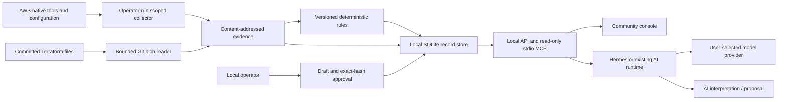

# Current storage and runtime update — rc7

The local SQLite-only description below records the original implementation. Optional S3 mode now persists records and uploaded originals before success and reconstructs the cache on new compute. See [durable workspace](DURABLE-WORKSPACE.md) and [standalone AWS console](AWS-WORKSPACE.md) for current boundaries. One active writer per prefix; Hermes remains separate.

# Community Edition v0.1: evidence before interpretation

This document describes the local console in `rgce/`. The separate Terraform/Hermes
host deployment and Lambda kiosk are preserved extensions, not a dependency of the
v0.1 local experience. Their deployment has not been revalidated by this release.

## The deterministic layer

Deterministic means that the same rule code and the same inputs produce the same
finding. It does **not** mean the evidence is complete, the configuration is safe,
or a possible exposure is exploitable. Three carried-forward configuration packs
cover security groups, S3 public access and IAM policy breadth.

| Information | Origin label | What is pinned | Who may change it? |
|---|---|---|---|
| Collected configuration or provider finding | `source_evidence` | Source scope, observation time, adapter, content hash, collection errors | New snapshot only |
| Local rule finding | `deterministic_check` | Evidence hash, rule version, SHA-256 of rule and envelope code, fixed severity | New assessment only |
| Reviewed organizational context | `human_approved_context` | Exact draft hash, assessment and evidence, reviewer, timestamp | New version only |
| Model explanation or proposed reasoning | `ai_interpretation` | Assessment, row, declared model, citations, import time | New annotation only; remains unreviewed |
| Proposal generated without a model | `deterministic_template` | Finding, evidence, rule version and approved knowledge references | User reviews the draft; CE executes nothing |

Native provider results stay source evidence: normalization by deterministic code
does not make the provider's underlying detection deterministic. Provider severity
is kept intact, separately from local rule severity. AI text cannot assign or
rewrite either severity through the product API.

The UI displays origin badges. JSON and MCP return the same origin fields and
references. External clients are responsible for displaying them faithfully.
Citation validation establishes that a record exists in the right investigation;
it does not establish that the claim is supported by that record.

## Components and authority

The cloud collector is an explicit CLI operation, not a browser or MCP tool. It
uses base credentials only to assume the named CommunityReadOnly role. A scoped
session policy allows only the adapter's read operations in selected regions.
The role's own policies still apply. Retries are disabled; each data request page
consumes one call from the budget. One STS AssumeRole request is additional.
Partial regions, pagination failures, denied access and unexpanded prefix lists
are recorded. Native findings require the source service to be enabled already;
CE does not enable paid AWS products.

The local console binds only to 127.0.0.1. It checks Host, Origin, browser fetch
metadata and a per-process token for writes. It uses same-origin assets, a CSP,
text-only source rendering and bounded imports. This is **single-operator local
software**, not an authenticated multi-user server. Any process running as the
same user can access its data. Do not reverse-proxy it onto a shared network.

MCP exposes nine read-only domain tools. None collects cloud data, writes knowledge,
approves a proposal, executes commands or invokes Terraform. The server can read
all records in its configured workspace, so use separate RGCE_HOME directories
for separate customers and trust boundaries. stdio avoids publishing an unauthenticated
network MCP endpoint. Local HTTP API access is for local integrations only.

## Knowledge lifecycle

The initial implementation salvages the useful OKF ideas: drafts, explicit review,
immutable approved versions, content hashes, optimistic expected-hash checks and
provenance. It does not embed another agent runtime. Knowledge is tied to an exact
assessment, so an old approval is not silently reused for a new snapshot.

This first version lacks semantic search, cross-assessment organization-wide
knowledge promotion, expiry policies and enterprise reviewer identity. Context
has to be reviewed for the next assessment. A local review is an operator
assertion; it is not an independently authenticated approval or evidence of a
cloud change. SQLite records are append-only through CE interfaces; a disk
administrator can alter or remove them. Hash verification detects body changes
but is not a signature or tamper-proof audit log.

## Reassessment must fail closed

Only SG rule clearance is implemented in v0.1. The later snapshot must have a newer
observation timestamp within 24 hours, complete collector coverage, no collection
errors, identical account/regions, the same rule code hash and version, and the
previously affected resource still present. Demo and real snapshots cannot mix.
Then CE can say `RULE_NO_LONGER_MATCHES`. It cannot prove the change caused the
clearance, prove reachability or mark a whole incident resolved.

An import cannot declare itself a trusted collector or grant itself complete
coverage. Native-finding disappearance, deleted resources, changed scope, old
evidence, incomplete collection and unsupported rule types remain `UNKNOWN`.
Positive findings in partial evidence remain useful, but absence is not a pass.
The legacy desk comparison also now says `NOT_OBSERVED`, not `RESOLVED`.

## Runtime, builder and compute

Hermes remains upstream software. CE supplies domain tools, evidence contracts
and a workflow skill; Hermes supplies model connections, conversations and its
native configuration tools. No bespoke OpenAI/Anthropic/provider transport is
implemented. Run a dedicated profile; updates to Hermes require a small MCP and
skill compatibility test instead of merging a fork.

Profile files alone are not security isolation. For real source material use a
separate OS user or container with no admin credentials, no builder identity and
only the intended CE workspace. An MCP client can possess other tools; this
server's read-only interface cannot constrain those tools.

The builder and Lambda kiosk are optional developer infrastructure. Keep separate
identities, filesystem mounts and deployment gates. v0.1 does not activate them or
claim the earlier shared-UID deployment already provides that separation. A future
action adapter should receive an exact approved plan, scope, expiry and idempotency
key, recheck policy outside the model, execute with a separate identity, and collect
new evidence. Cloud mutation and automatic IaC apply remain outside v0.1.

## Portability

Store, origin labels, approval records, proposals and MCP do not depend on AWS.
Provider-specific reads and rule packs stay at the adapter boundary. Azure and GCP
need their own scoped collectors, normalization, coverage tests and reference
fixtures before their integrations can be marked ready. Merely giving an agent
the az or gcloud CLI does not provide equivalent read-only enforcement.

The rc2 source library extends knowledge beyond assessment notes: see [Knowledge intake](KNOWLEDGE-INTAKE.md). Source documents remain unreviewed; approved insight notes can cite their exact hashes.

rc3 extends the earlier assessment-note model with reusable concepts, exact-version
relationships, scope resolution and manual refresh propagation. See
[Knowledge quickstart](KNOWLEDGE-QUICKSTART.md) for the implemented contract.
